# 双相机 real2sim 标定记录（SEP 730，Joe 的部分）

日期：2026-11-18 至 2026-11-20
目标：把实验台上的两个真实相机（Logitech Brio 100，`top` 俯视、`side` 侧视）放进 MuJoCo 场景，使 sim 渲染的画面和真实相机的画面在几何上重合。
最终产物：

| 文件 | 内容 |
|---|---|
| `real2sim/cameras/calib/top_intrinsics.json`、`side_intrinsics.json` | 内参 K 和畸变系数 |
| `real2sim/cameras/calib/cameras.json` | 两个相机在 sim 世界坐标系里的位姿（含 MuJoCo `xyaxes`）、内参、每一步的统计量 |
| `src/orca_sim/scenes/v2/scene_right_cube_orientation_real2sim.xml` | 方块任务场景 + 两个标定好的相机 + 真实桌面 |
| `real2sim/cameras/rig.yaml` | 实验台的全部测量值及换算过程（注释里写明） |
| `docs/figures/real2sim/` | 本文的所有图 |

最终结果见图 F（第 7 节）：sim 的手（洋红色轮廓）与真实的手在两个视角下都重合，偏差约 10–20 px（约 3–5 mm）。

---

## 1. 方法概述

真实相机 → sim 相机需要两组参数：

1. **内参**（焦距 fx、fy，主点 cx、cy，镜头畸变 k1 k2 p1 p2 k3）：只和镜头有关，用标定板拍多张照片求出。
2. **外参**（相机在 sim 世界坐标系里的位置和朝向）：sim 世界坐标系由手定义，所以外参必须经由一个"相对于手位置已知"的物体求出。

外参的链条是：

```
T_world_cam = T_world_board · T_board_cam
               (手量：棋盘相对于手)   (图像：solvePnP，精度 < 1 mm)
```

`T_board_cam` 由图像自动求出，非常准；`T_world_board` 靠卷尺测量棋盘相对于手前臂塔的位置，是整个流程的主要误差来源。

### 1.1 坐标约定

- sim 场景 `scene_right_cube_orientation.xml`：手安装在 (0, 0, 0.16)，手指指向 +x，掌心朝 +z，拇指在 −y 一侧。
- 前臂塔（黑色前臂块，sim 里是 `ForeArmStructure` + `TopTower` 两个 body）范围：x −0.058…0.099，y −0.057…0.037，z 0.112…0.208（单位 m）。
  - **前端面** x = 0.099（塔朝手指方向的截止面，真实手上就在超声波传感器靠手指一侧）。
  - **小指侧面** y = 0.037。
  - 校验：sim 塔宽 94 mm，真实塔量得 93 mm。
- OpenCV 相机坐标（x 右、y 下、z 前）→ MuJoCo 相机坐标（x 右、y 上、看向 −z）：`R_mj = R_cv · diag(1, −1, −1)`，MuJoCo 的 `xyaxes` 取 `R_mj` 的前两列。
- MuJoCo 3.x 相机用真实内参：`resolution="W H"`、`sensorsize`、`focalpixel="fx fy"`、`principalpixel="W/2−(cx+0.5)  H/2−(cy+0.5)"`。
  注意 `principalpixel` 是相对图像中心的偏移，且有 0.5 px 的像素中心约定差；这个公式用合成数据验证过，主点误差 < 0.1 px（最初写错符号时误差为 19.5 px）。

### 1.2 标定板

- ChArUco 板：7 × 5 格，方格 35 mm，ArUco 标记 26 mm，字典 DICT_5X5_100（方块上的 AprilTag 用 36h11，二者不会混淆）。
- 用 `make_targets.py` 生成，US Letter 纸 100% 打印，贴在 4.53 mm 厚的硬板上。
- **打印尺寸校验**：100 mm 检查条 = 100 mm；7 格总长 245.0 mm（35.00 mm/格），5 格总长 174.5 mm（34.90 mm/格），差异在钢尺读数误差内，`square_mm` 保持 35.0。
- ChArUco 相比普通棋盘格的好处：每个角点有编号，只拍到部分板子也能用，这对拍画面边角很关键。

### 1.3 合成数据验证（先验证程序，再上真机）

`tests/test_real2sim_cameras.py` 用 MuJoCo 自己扮演"真实相机"：已知内参、已知畸变、已知位姿的相机拍棋盘，再让整条流程从图像里把它们还原出来。结果：

| 项目 | 真值 | 还原值 |
|---|---|---|
| fx（top） | 1000 | 998 |
| k1（top） | −0.08 | −0.085 |
| top 位置 / 朝向误差 | – | 3.37 mm / 0.293° |
| side 位置 / 朝向误差 | – | 0.48 mm / 0.055° |
| sim 与"真实"角点重合误差（含没参与标定的新位置） | – | 0.05–0.11 px |

结论：程序本身的误差远小于后面真机测量的误差。

---

## 2. 内参标定

工具：`capture.py <session>`（两个相机预览并排，SPACE 保存）→ `calibrate_intrinsics.py <session> --cam X`（`cv2.calibrateCamera`，自动剔除重投影误差 > 3 倍中位数的照片，打印 3×4 的角点覆盖表）。

### 2.1 过程与教训（这一节是论文里"实践经验"的素材）

内参前后拍了四轮才合格，每一轮的问题都很典型：

| 轮次 | 结果 | 问题 | 诊断依据 |
|---|---|---|---|
| 1 | top fx 1362，side fx 2141、k3 = 24.9 | 覆盖不全：top 右半边没有角点，side 最左列和最下行为 0 | 覆盖表；两个同型号相机 fx 差 57%，k3 数值不合理 |
| 2 | top fx 1762，side fx 1962 | side 有 70 张几乎相同的照片（自动保存时棋盘不动）；20 张离得太近、失焦（清晰度 ~13，正常 ~40） | 逐张统计角点位置和 Laplacian 清晰度（图 A1） |
| 3 | side RMS 0.91 px | 纸没有贴平，棋盘呈波浪形 | 照片里格线弯曲（图 A2） |
| 4 | side RMS 0.55 px，但最下一行覆盖为 0 | side 相机几乎贴着桌面，棋盘立在桌上时下沿始终停在 y≈560 的桌面线 | 所有照片的角点 y 最大值都 ≈ 560（图 A3） |
| 4+ | side 补拍 16 张（暂时把相机抬高），RMS 0.59 px，12 格全覆盖 | 合格 | – |

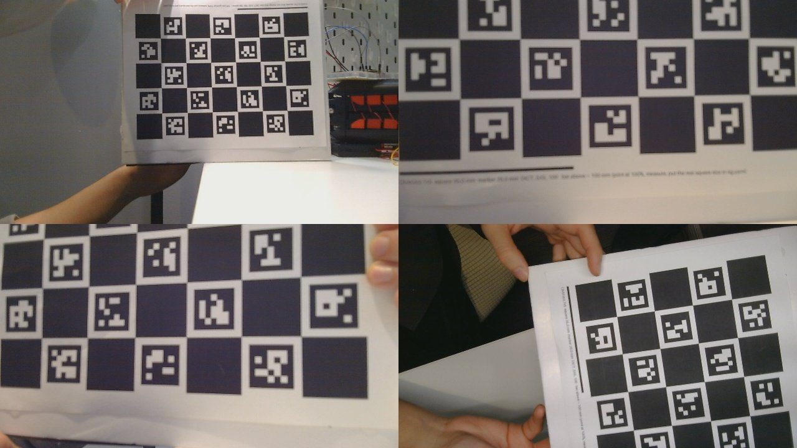

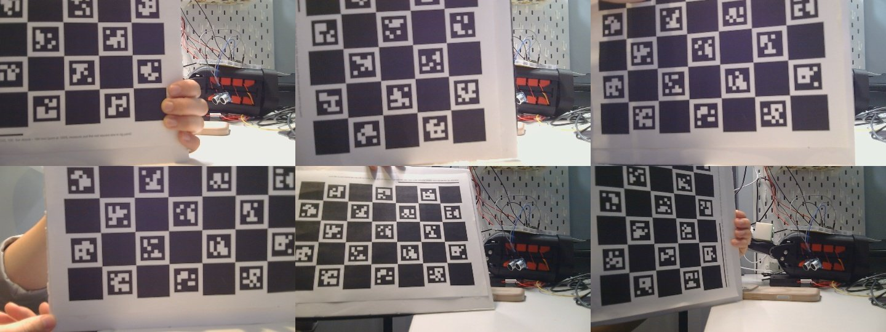

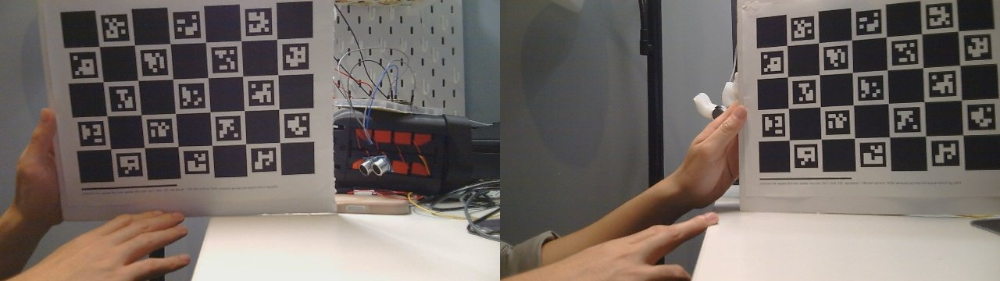

要点：

- **RMS 小不代表结果对。** 第 1 轮 side 的 RMS 只有 0.46 px，但 fx 错了 57%。覆盖不全时，算法可以用错误的焦距 + 夸张的畸变去拟合中间那块区域。
- **用同型号相机互相印证**很有效：两个 Brio 100 的 fx 应该接近；再用规格核对（Brio 100 对角视场 58°，1920×1080 下 fx ≈ 1987）。
- 定焦相机（Brio 100）离得太近会失焦；棋盘要完整入画、占画面宽度的 1/4–1/2。
- 内参与相机放在哪里无关，所以可以暂时移动相机来补拍拍不到的区域。

### 2.2 最终内参（1920 × 1080）

| | top | side |
|---|---|---|
| 照片数 | 32 | 43 |
| RMS 重投影误差 | 0.675 px | 0.587 px |
| fx, fy | 1960.11, 1956.53 | 1935.71, 1931.20 |
| cx, cy | 981.47, 525.55 | 945.93, 502.02 |
| 视场 水平 / 垂直 | 52.2° / 30.9° | 52.8° / 31.2° |
| k1, k2 | 0.1728, −0.8304 | 0.1739, −0.7092 |
| p1, p2 | 0.0019, 0.0006 | 0.0008, 0.0007 |
| k3 | 1.1616 | 0.4968 |

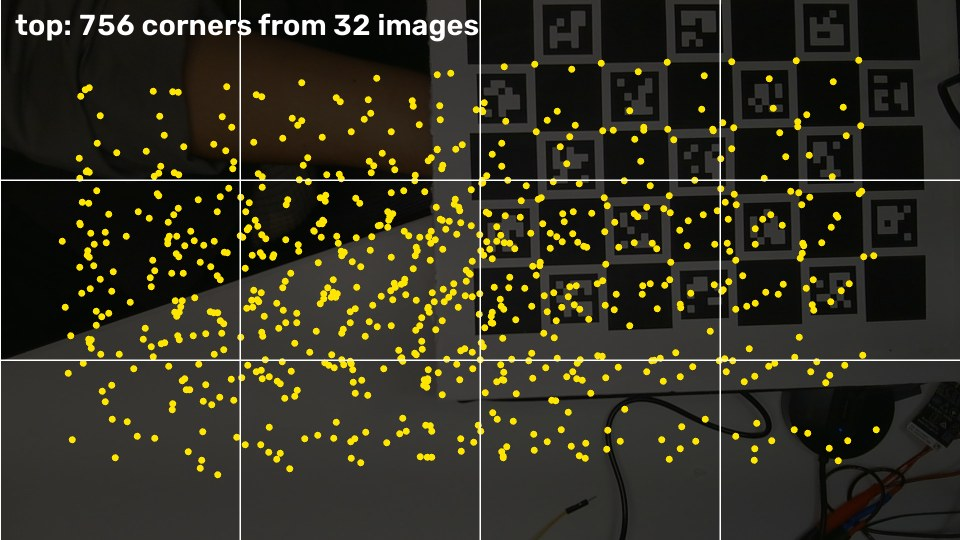
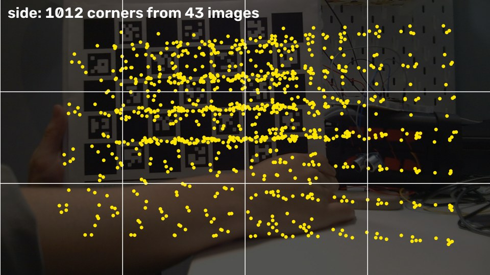

- top 的 RMS 0.675 px 略高于 0.5 的经验目标。逐张检查：每张误差都在 0.39–1.03 px 之间、分布均匀，没有单张离群，删任何一张都不会明显改善，推测来自手持晃动和 MJPG 压缩。换算到 50 cm 处约 0.17 mm，可以接受。
- 两个相机 fx 相差 1.3%，畸变系数接近，属于同型号个体差异，互相印证了结果。
- MuJoCo 渲染的是无畸变针孔图像，所以真实帧在和 sim 对比、或输入给 sim 训练的策略之前，都要先 `cv2.undistort(img, K, dist)`。

---

## 3. 相机摆放

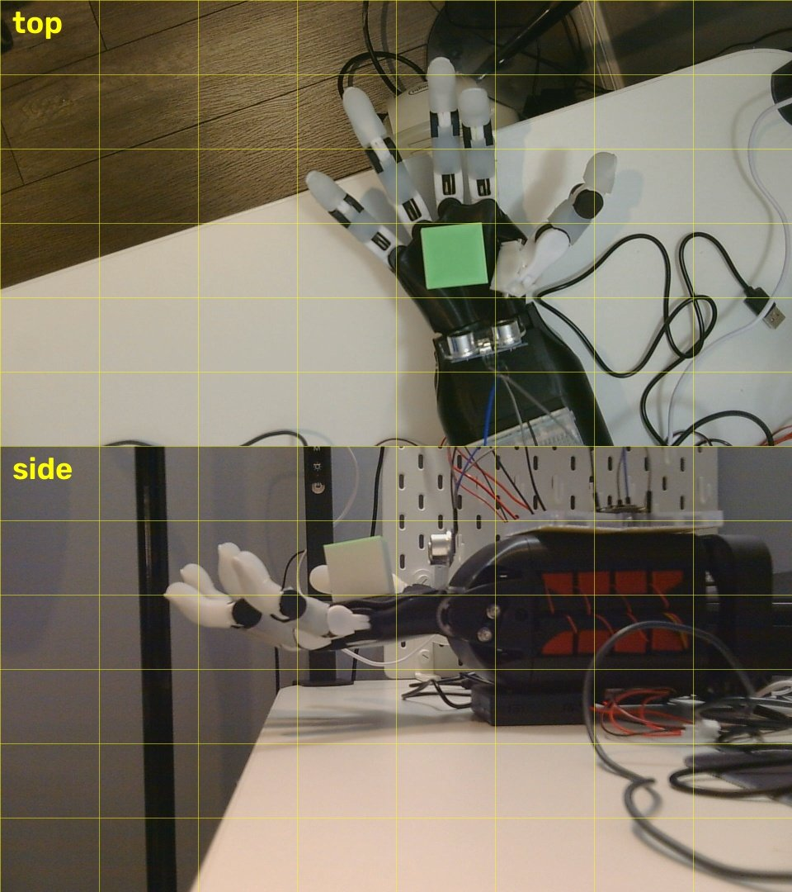

- top：几乎正俯视，整只手和方块活动范围都在画面里，指尖离上边缘约 140 px。
- side：从小指一侧看过去，约 54 cm 远，比桌面高约 5 cm。
- 外参拍完以后，相机和手都不能再动（这一点在实际操作中出了两次问题，见第 4.3 和 5.2 节）。

---

## 4. top 外参

### 4.1 棋盘摆放与测量

- 棋盘**平放**在手的小指一侧，长边用直尺靠住塔的小指侧面以保证平行。
- top 相机看到 24/24 个角点（图 C2）。

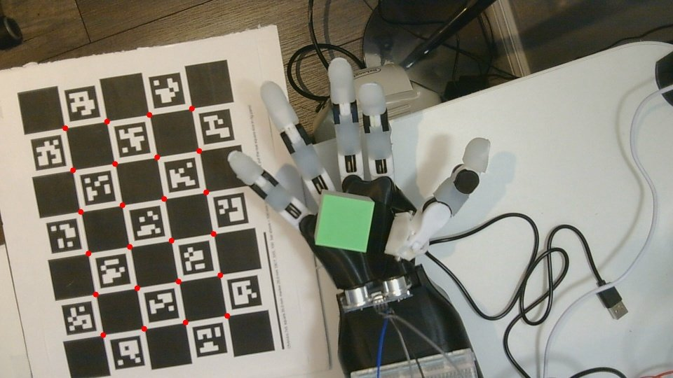

需要量的量（图 C3 标出了两个参考面）：

- **H**：塔底面离桌面的高度 = 20 mm → sim 里桌面在 z = 0.112 − 0.020 = **0.092**。
- **T**：硬板厚度 = 4.53 mm。
- **D**：塔的前端面（红）→ 棋盘格子图案远端（靠指尖一侧）的边，沿手指方向。
- **B**：塔的小指侧面（蓝）→ 棋盘格子图案最近的边，垂直于手指方向。

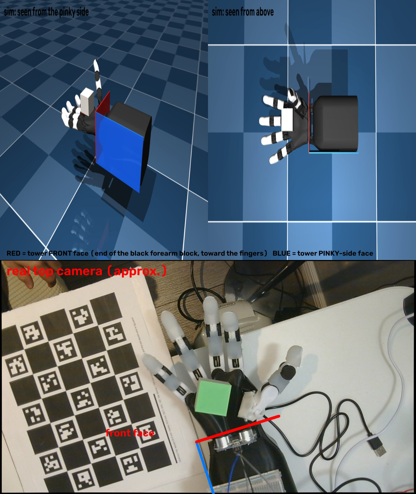

换算（棋盘 245 × 175 mm，半长 0.1225、半宽 0.0875）：

```
中心 x = 0.099 + D − 0.1225
中心 y = 0.037 + B + 0.0875
中心 z = 0.092 + T
```

### 4.2 第一次测量（D = 201 mm，B = 55 mm）

- 相机位置 (0.197, −0.019, 0.663) m，5 帧之间位置差 0.9 mm、角度差 0.09°。
- 把 sim 的手按这个位姿渲染出来，叠到真实画面上，看刚体的前臂塔：边缘偏差约 10–20 px（约 3–5 mm）。

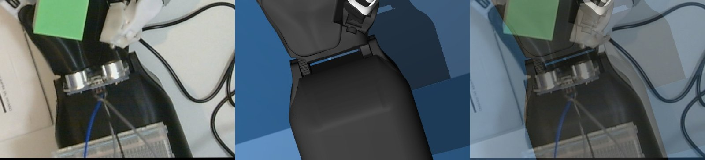

**尝试过但放弃的自动修正**：在塔的区域做轮廓（暗色像素）的 IoU 最大化，搜索 (dx, dy, dyaw)。IoU 从 0.534 升到 0.604，但最优解 dx = +8 mm 落在搜索范围的边界上，说明它在"凑"。原因是真实塔上放了面包板和线缆，黑色外壳还有反光，轮廓提取不干净。所以没有采用。

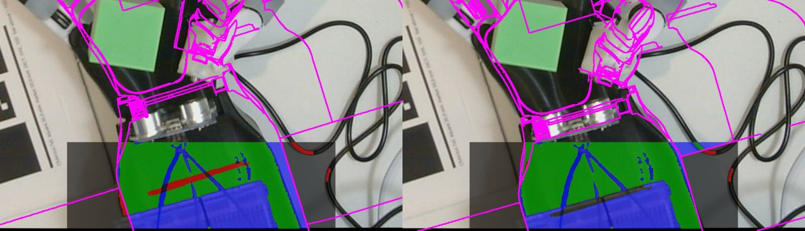

### 4.3 手被移动后重测（D = 209 mm，B = 50 mm）

手的位置变了，top 外参必须重做（sim 坐标系跟着手走，相机本身不用动）。

- 重测时有两个意外，都靠检查结果发现：
  1. 文件夹里混入了手移动前的 5 张旧照片 → 9 帧之间位置差 216 mm。把旧照片移走后恢复正常。
  2. 棋盘方向放反了（100 mm 横线朝外）→ 相机算到 y = 0.363，sim 的手完全不在画面里。按照片把 `yaw` 改成 180° 后恢复正常。**不需要重拍**，只是配置里的朝向错了。
- 最终：相机位置 **(0.197, −0.014, 0.664) m**，4 帧，重投影 0.42 px，帧间差 0.46 mm / 0.045°。
- **重复性**：两次独立摆放、独立测量，相机位置只差约 5 mm（−0.019 vs −0.014），说明卷尺测量的精度在 5 mm 左右。

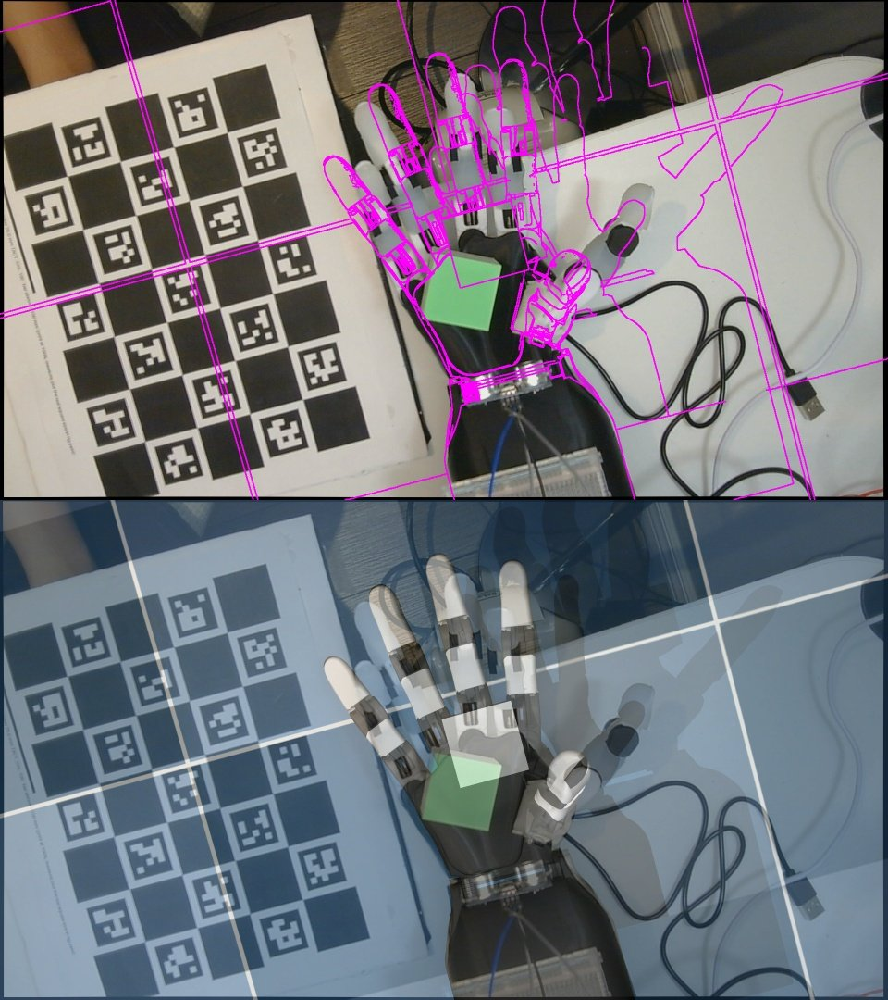

### 4.4 top 相机被轻微碰到之后的修正

拍完 top 外参后相机被碰了一下。用 `correct_bump.py` 修正，不用重拍：

- 把外参照片和碰后的新照片做 ORB 特征匹配（背景静止），356 个匹配点。
- 固定在夹子上的相机被碰，主要是绕自身转动，所以用**纯旋转**模型拟合两组视线方向（SVD）：转了 **0.171°**，残差中位数 **0.93 px**。残差这么小，说明纯旋转假设成立；如果相机还平移了，残差会有好几个像素，程序会拒绝修正并要求重拍。
- 0.17° 在手的位置约 1.5 mm。

---

## 5. side 外参

### 5.1 尝试过但放弃的方案

1. **棋盘立在手和 side 相机之间、量位置并对齐角度**：手动对齐竖直和平行太难，误差大。
2. **两个相机同时看一块斜放的棋盘**（棋盘的世界位姿由已标定的 top 给出，side 一个数都不用量；代码已实现：`calibrate_extrinsics.py --via side=top:SESSION`）：理论上更好，但实际中 side 相机离手只有约 30 cm，斜放的棋盘总有一个相机看不全（图 E1），放弃。

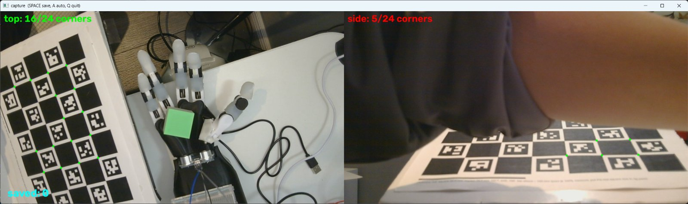

### 5.2 最终方案：棋盘贴着塔立起来

- 棋盘**背面贴紧塔的小指侧面**立在桌上，印刷面朝 side 相机，横线在下（图 E2）。这样**竖直和平行自动满足**，只需要量两个短距离：
  - **a** = 130 mm：塔的前端面 → 格子图案靠指尖一侧的边。
  - **M** = 45 mm：桌面 → 格子图案下边缘。
- 期间 side 相机被碰，删掉旧照片重拍；side 相机向后移动到约 54 cm。

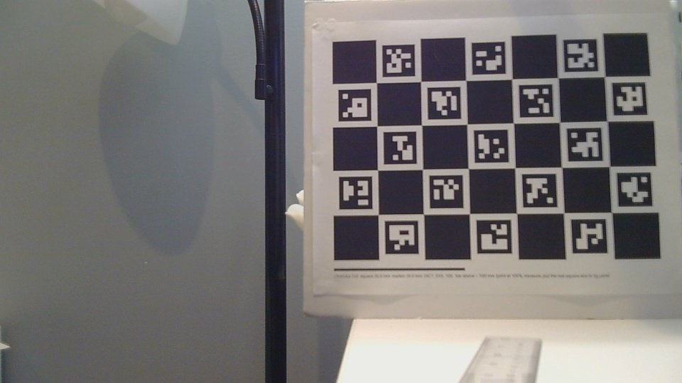

换算（棋盘朝 +y、正立，对应 `yaw = 180°、tilt = 90°`）：

```
中心 x = 0.099 + a − 0.1225 = 0.1065
印刷面 y = 0.037 + T = 0.0415
中心 z = 0.092 + M + 0.0875 = 0.2245
```

结果：相机位置 **(0.190, 0.578, 0.140) m**，看向 (0.068, −0.991, 0.113)，5 帧，重投影 0.53 px，帧间差 1.66 mm / 0.164°。

---

## 6. sim 场景的补充：真实桌面

叠加检查时 top 视角出现两个"残影"（图 F1），原因是：

- sim 场景有两盏会投射阴影的灯，手在地面上投下两个影子；
- sim 的地面在 z = 0，比真实桌面低 92 mm，斜射光让影子远离手。

关掉阴影后残影消失（图 F2），说明这与相机标定无关。

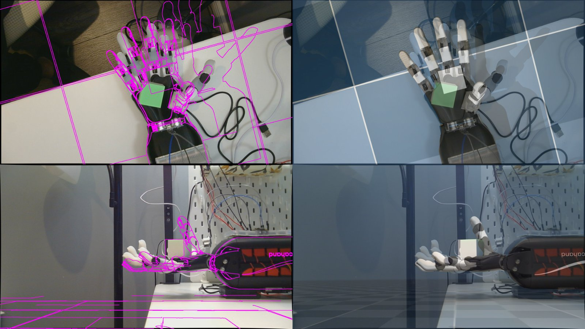
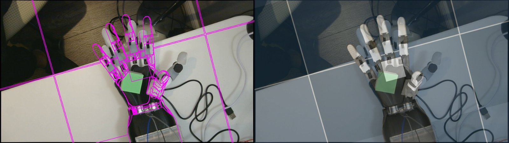

处理：在 `_real2sim` 场景里加一个顶面在 z = 0.092 的桌面（`rig.yaml` 的 `bench`），**训练用的场景不变**（训练环境用 `z < 0.05` 判断方块掉落，改原场景的地面会破坏它）。验证：方块掉在手旁边，静止在 z = 0.1108（理论值 0.092 + 0.018 = 0.110）；side 视角里 sim 桌面边缘和真实桌面重合（图 F3）。

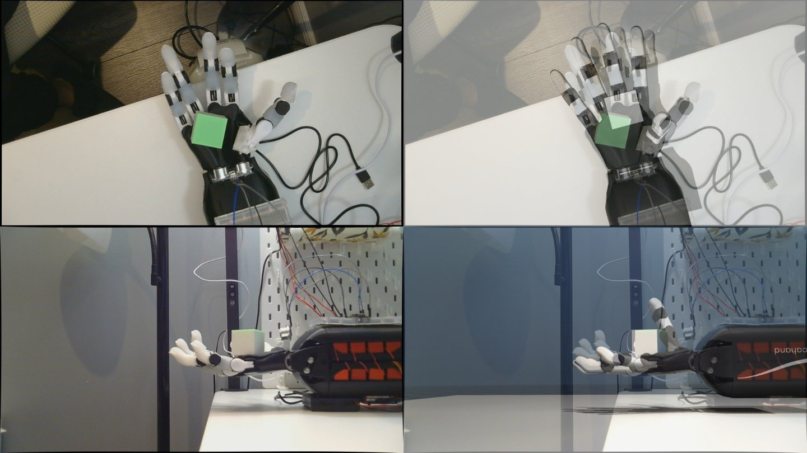

注意：若用 `_real2sim` 场景跑任务环境，`drop_height` 要相应改到约 0.13。

---

## 7. 最终结果

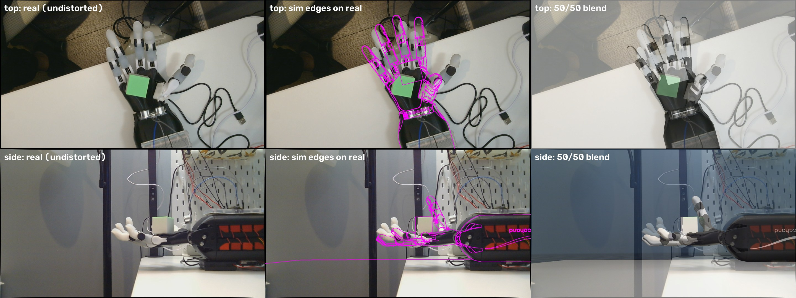

| | top | side |
|---|---|---|
| 位置 (m) | (0.197, −0.014, 0.664) | (0.190, 0.578, 0.140) |
| 外参重投影 | 0.42 px | 0.53 px |
| 帧间一致性 | 0.46 mm / 0.045° | 1.66 mm / 0.164° |
| sim 与真实的手（目测，刚体部分） | 10–20 px（3–5 mm） | 10–20 px（3–5 mm） |

- 对得上的：前臂塔、手腕、超声波传感器、手掌位置；side 视角的桌面。
- 对不上但与标定无关的：手指（sim 关节在默认角，真实手是另一个姿态；用真实舵机角度驱动 sim 关节即可对齐）。

### 7.1 误差来源与精度预算

| 来源 | 量级 |
|---|---|
| 相机相对棋盘（solvePnP，多帧平均） | < 1 mm，< 0.2° |
| 内参 | 0.6–0.7 px RMS ≈ 0.2 mm @ 50 cm |
| 棋盘相对手（卷尺 + 目测对齐） | ±1–2 mm，±1–2°，主要误差 |
| top 碰撞修正 | 0.17°，残差 0.9 px |
| sim 模型与真实手的差异 | 塔宽 94 vs 93 mm |
| **合计（两次独立测量的重复性）** | **约 5 mm** |

### 7.2 局限与后续

- 还没有做定量的独立验证（把棋盘放到一个新的、量过的位置，算角点误差）。`overlay.py` 已支持。
- 手指关节状态未知，目前只用刚体部分（塔、手腕）检验。
- 更高精度的方案：在前臂塔上贴一个位置已知的标记，去掉卷尺测量这一环。
- 真实桌面在指尖前方就到边了，sim 桌面没有建模这个边缘。
- 相机或手一旦移动，外参就要重做；内参不用重做。小幅碰撞可以用 `correct_bump.py` 修正。

---

## 8. 超声波数字孪生（2026-11-20）

- HC-SR04 由 ESP32-S3 驱动（`ORCA Ultra Sonic/src/main.cpp`，TRIG 10 / ECHO 18，每 100 ms 测一次，输出 `Distance: xx.x cm`），接在 COM4（FTDI）；手的舵机适配器在 COM3。
- `hardware/ultrasonic/read_ultrasonic.py` 改为监听哪个端口在输出距离来找端口，不向任何端口写数据。
- 传感器装在透明支架上，探头高度对准手掌上方块的中部，正对方块近面（用户确认读数就是方块表面的距离）。

### 8.1 传感器位置（用相机定位，不用尺子）

- 两个探头的前端面在 top 画面里都看得到，+y 一侧的探头在 side 画面里也看得到（用 top 视线在 side 图像里画极线确认对应点）。+y 探头用两个相机三角测量，−y 探头用 top 视线与同一高度平面求交。
- 结果：两探头间距 **26.4 mm**（HC-SR04 规格 26 mm），中心 (0.1069, −0.0107, 0.2010) m，朝向水平、偏 −15.2°（垂直于两探头连线，指向手指）。高度由几乎水平的 side 相机决定；top 相机几乎正俯视，只决定水平位置。
- 写入 `rig.yaml` 的 `ultrasonic`，生成到 `_real2sim` 场景里。

### 8.2 sim 传感器模型

- 真实 HC-SR04 返回一个圆锥（约 15° 半角）内最近的回波，所以 sim 里用 25 条 rangefinder 射线组成圆锥（轴线 + 3 圈 × 8 条），读数取最近的命中。
- 只用一条射线时，sim 射线从方块旁边擦过、完全打不到；7.5° 圆锥读 41.7 mm；15° 圆锥读 28.4 mm。圆锥模型是必要的。
- 工具：`real2sim/ultrasonic/twin_check.py`（定位传感器、用相机估计真实方块姿态、对比 sim 与真实读数）。

### 8.3 距离实验（方块面与传感器平行）

每个位置同时拍两个相机并读传感器（读数取中位数）。"相机"一栏是在 side 画面里、传感器高度上量出的探头前端面到方块近面的水平距离，作为参考值；"sim"是把 35 mm 方块按相机估计的姿态放进 sim 后的读数。

按距离排序（位置编号是采集顺序；单位 mm）：

| 位置 | 方块所在 | 相机（参考） | 真实传感器 | sim 几何距离 | sim 标定后 | sim − 真实 |
|---|---|---|---|---|---|---|
| 1 | 靠近手腕 | 4.6 | 20.0（恒定） | 5.3 | 20.0 | 0.0 |
| 2 | 手掌中间 | 27.0 | 33.0 | 23.9 | 26.8 | −6.2 |
| 4 | 约 4 cm | 42.2 | 39.0 | 40.0 | 42.9 | +3.9 |
| 3 | 手掌远端 | 61.4 | 61.0 | 57.8 | 60.7 | −0.3 |
| 5 | 中指第二指节上 | 77.1 | 80.0 | 74.4 | 77.3 | −2.7 |
| **6（验证）** | 约 5 cm，新位置 | 54.0 | 52.0 | 53.0 | 55.9 | **+3.9** |

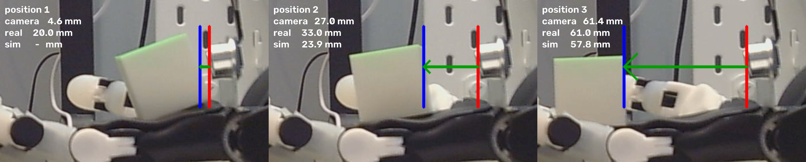

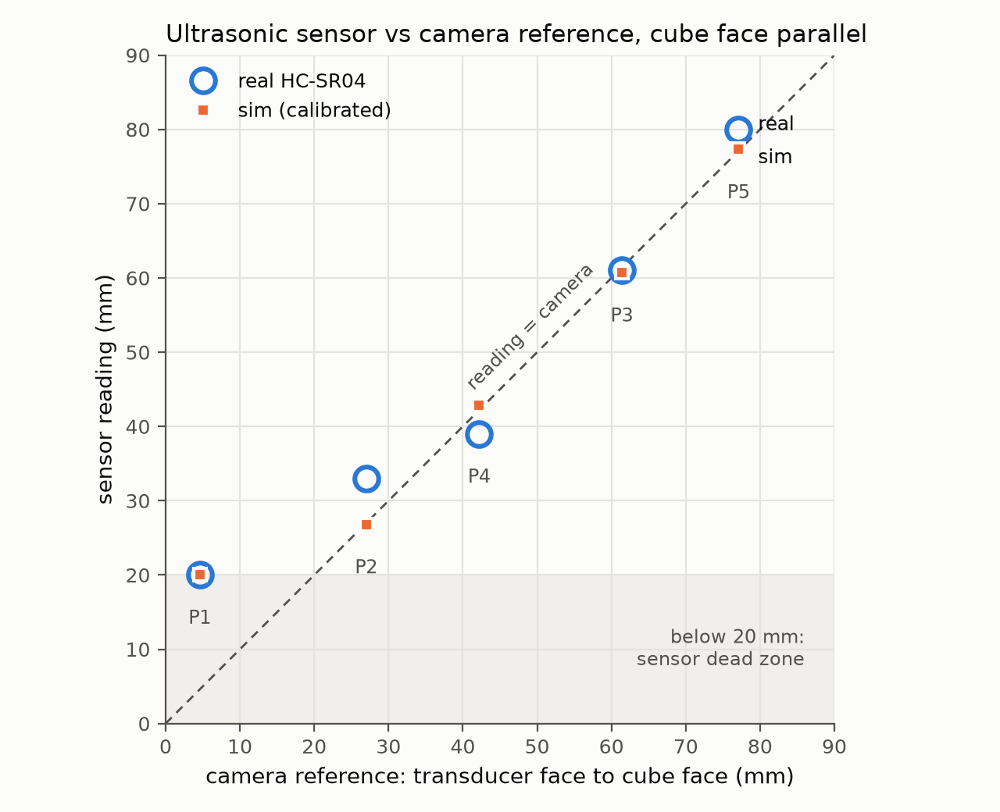

结论：

- **真实传感器**（位置 2–5）：线性拟合 读数 = 0.97 × 相机 + 3.1 mm，残差约 ±4 mm，没有明显的固定偏差或比例误差；这个离散程度与相机参考值本身的误差（边缘取点 ±1.5 mm、相机外参约 3–5 mm）相当。2 cm 以内进入盲区，读数卡在 20 mm。
- **sim 几何距离**：比相机参考值稳定地短 **2.9 ± 0.6 mm**（位置 2–5），是一个固定偏差：0.5 mm 来自 sim 方块（36 mm）比真实方块（35 mm）大，其余来自 top 与 side 相机之间的微小不一致（方块水平位置用 top 相机，参考距离用 side 相机）。位置 1 的几何距离 5.3 mm 与相机 4.6 mm 一致。
- **标定后的 sim 传感器**：读数 = max(圆锥内最近命中 + 2.9 mm, 20 mm)，参数写在 `rig.yaml`（`range_offset_m`、`min_range_m`）。与真实传感器相比：盲区一致；位置 2–5 平均绝对误差 3.3 mm，RMS 3.9 mm（样本内，偏移量就是用这 4 个点标定的）。
- **样本外验证**：参数固定后，在一个新位置（6，约 5 cm）测试：sim 55.9 mm，真实 52.0 mm，误差 **+3.9 mm**，与样本内误差同一量级，说明标定的模型对新位置同样成立。
- 方块倾角用相机估计值还是假设竖直、以及是否加入反射角限制（入射角 < 20°），结果都只差 &lt; 1 mm，因为这些位置的面都正对传感器。
- 用户观察：方块面不平行于传感器（例如转 45°）时读数会变。这是超声波的镜面反射：斜面把声波反射到别处。圆锥最近距离模型不包含这一点，下一步用贴 AprilTag 的方块、在手指拨动方块的真实过程中逐帧采集，加入入射角模型后对比。

### 8.4 同步录制（三路数据对齐）

为后续"手指拨动方块"的实验，写了同步录制工具 `real2sim/recording/record.py` 和对齐工具 `align.py`：

- 三路数据（top 相机、side 相机、超声波）在同一个进程里各开一个线程，数据一到达就用**同一个时钟**（`time.perf_counter`）打时间戳；原始数据分别保存（`top_frames.csv`、`side_frames.csv`、`ultrasonic.csv`、图片文件夹、`meta.json`）。
- `align.py` 给每个超声波读数配上时间最近的 top 帧和 side 帧，输出 `aligned.csv`：`t, us_mm, top_file, top_dt_ms, side_file, side_dt_ms, ok`。`dt_ms` 是帧与读数的时间差，`ok = 1` 表示两帧都在 25 ms 以内；不删行，只标记。
- 测试中发现并修复了一个错位问题：串口在相机启动（约 1 分钟）期间就已打开，FTDI 驱动积压了 602 行旧读数，`reset_input_buffer` 也没有清掉，它们在录制开始时一次性到达、被打上错误的时间。修复：相机就绪后才打开串口，并丢弃积压直到出现正常的约 100 ms 间隔；`align.py` 会检查间隔，发现读数挤在一起时报警。
- 修复后的 8 秒测试：top 30.0 fps、side 30.2 fps、无丢帧；超声波每秒 10 个；78 个读数中 74 个两帧都在 25 ms 以内（时间差中位数 8.9 ms），其余 4 个落在相机偶尔 80 ms 的帧间隔附近，已标记。
- 到达时间不等于采集时间：相机有曝光和 USB 传输延迟，超声波有 FTDI 约 16 ms 的缓冲。这些延迟基本固定，用同步测试测出后写在 `real2sim/recording/latency.json`，`align.py` 默认使用。
- 录制工具有提示窗口：相机启动中 → 3 秒倒计时 → 红框"● 正在录制"（显示剩余时间和实时超声波读数），CSV 里只保留倒计时结束之后的数据。

**延迟测试**（`real2sim/recording/latency.py`）

1. sync01：方块没有动（动作做在了录制开始之前），无法计算 → 加了提示窗口。
2. sync02：手推方块沿光束方向来回 5 次。用"相机测得的方块到传感器距离"和超声波读数做互相关，得到 top +148 ms、side +86 ms，但相关峰非常平（±100 ms 内几乎一样高），用"动作起点"比较的结果也互相矛盾。原因：推动是约 0.3 秒的慢斜坡、中间是长平台，超声波只有 10 Hz，方块靠近时还会读到盲区和反射的异常值（1550 mm、780 mm，用 3 点中值和 15–150 mm 范围剔除）。结论：这种测试测不准，结果作废。
3. sync03：**瞬间事件**。方块拿开，用卡片快速插进传感器前方再抽出，重复多次。超声波从"无回波"跳到几厘米；相机只看传感器前方 8 cm 光束在画面里对应区域的帧间变化，事件精度一帧（33 ms）。

| 对比 | 中位数 | MAD | 事件数 |
|---|---|---|---|
| top − 超声波 | +9 ms | 8 ms | 6 |
| side − 超声波 | −27 ms | 22 ms | 6 |
| side − top | −49 ms | 14 ms | 5 |

结论：三路数据的到达时间本来就基本对齐（约一帧以内）。超声波每约 100 ms 采样一次，事件最多晚 100 ms（平均约 50 ms）才出现在读数里，这部分是随机的，无法用固定偏移修正，是这组数据时间精度的上限（约 ±50 ms）。用这组延迟对齐 sync03：197 个读数中 190 个两帧都在 25 ms 以内，时间差中位数 8 ms。

### 8.5 AprilTag 方块（为逐帧方块姿态做准备）

- 训练好的 PPO 观测的是关节状态 + 方块红色面的世界方向（3 维）+ 它离朝上还差多少（1 维），不看图像，所以真实部署只需要**方块的朝向**，不需要 YOLO 之类的检测器。用贴在方块上的 AprilTag 加标定好的相机得到方块姿态。
- 标签：AprilTag 36h11，id 0–5，按 35 mm 方块生成 27 mm 的标签（`make_targets.py`）。只要求 id 0 贴在绿色面（对应 sim 的红色面），其余标签可以随意贴在任意面、任意角度，位置由程序测出。
- 布局测量（`real2sim/cube/cube_tags.py capture / solve`）：手持方块在 top 相机下转动，自动保存同时看到 ≥ 2 个标签的帧（407 帧）。id 1 在 id 0 对面，只能经由侧面标签间接连到 id 0。由两两标签的相对位姿得到每个标签在方块上的位姿，方块坐标轴对齐到测得的面法向。

| 标签 | 面 | 法向偏离 | 偏离面中心 |
|---|---|---|---|
| 0 | +z（绿色面） | 0.0°（基准） | 1.8 mm |
| 1 | −z | 4.3° | 3.4 mm |
| 2 | −x | 0.8° | 1.9 mm |
| 3 | +x | 0.5° | 1.7 mm |
| 4 | −y | 0.3° | 1.8 mm |
| 5 | +y | 0.3° | 1.8 mm |

- 一致性：同一帧里由两个不同标签各自算出的方块姿态，中位数相差 3.1 mm / 2.6°（单个 27 mm 标签斜看时朝向噪声较大）。改为**所有可见标签的角点一起做一次 PnP**（`cube_pose_joint`），重投影中位数 3.0 px，与逐标签平均的朝向相差中位数 0.9°。
- 尝试过但放弃：交替优化标签布局和每帧姿态（无 scipy 时代替 bundle adjustment），误差从 3.5 px 发散到 23 px，已删除，布局保留未迭代的版本。
- 踩到的坑：OpenCV 5 的 `solvePnPRefineLM` 如果传入一维的平移向量 `(3,)`，结果会翻转约 180°；必须用 `(3, 1)`。

**两个相机的一致性检查（方块放在手掌上）**

1. 第一次检查是先拍 top、隔一两分钟再拍 side：两相机算出的方块中心差 25 mm。改用同步录制（两相机同一时刻，帧差 5.9 ms）后仍差 23.5 mm，所以不是方块移动造成的。
2. 差距主要在**各自的深度方向**上（top 的 z、side 的 y），两个相机都认为方块"更远"，等效于标签看起来比实际小。在两次独立的采集上分别求"让两相机最一致的标签尺寸"，得到 26.20 mm 和 26.26 mm（比例 0.970、0.9725），而尺子量的打印尺寸是 26.8–27.0 mm。结论：检测到的外角点比打印的黑框往里缩了约 2.8%（标签在画面里只有 90–130 像素，模糊和 JPEG 压缩会"吃掉"约 1 像素的黑边；棋盘格的角点是格子交叉点，不受这个影响）。`cube_tags.json` 里记录 `effective_tag_mm = 26.25`，重新求解布局后两相机差距从 23.5 mm 降到 10 mm。
3. 尝试过但放弃：两个相机的标签角点放进同一个 PnP 一起优化。每个相机只看到一个标签（4 个角点）时，算法会把方块朝向扭歪约 15° 来迁就两相机之间约 10 mm 的不一致，重投影误差 9–12 px。
4. 最终采用 **分开求解再融合**（`cube_pose_fused`）：朝向取两相机的平均；位置用加权最小二乘，每个相机垂直于视线的方向权重为 1、沿视线（深度）方向权重为 0.1。结果：每个相机与融合结果相差约 5 mm、3°；该姿态下 sim 超声波 30.6 mm，真实 33.0 mm（差 2.4 mm），与 8.3 节约 ±4 mm 的精度一致。
5. 精度小结：方块位置约 5–10 mm，朝向约 3–5°。剩余误差主要来自两个相机外参之间约 5–10 mm 的不一致（也体现在 8.1 节的射线间隙 7.5 mm 和 8.3 节 sim 的 2.9 mm 偏差上）。

### 8.6 用训练好的 policy 拨动方块（run01）

**动作来源**：`real2sim/policy/policy_to_replay.py` 在 sim 里运行训练好的 PPO（`models/ppo_reorient_relative`），方块朝向取相机测得的真实朝向（绿色面朝指尖，向下约 6°），位置取训练时的起始位置（直接用真实位置会让方块从默认姿态的 sim 手上滚落）。记录 sim 里实际达到的关节角，转换成 orca_core 的 `replay_continuous.py` 格式，由用户在真实手上回放（开环）。我们的程序不直接控制舵机。

安全措施：手腕动作强制为 0、文件中手腕固定在中立位 −9.6°；时间放慢 8.6 倍（任何关节不超过 60°/s）；所有角度截断在 config 的 `joint_roms` 内（真实 thumb_mcp 只有 −5°~40°，sim 是 −25°~100°，所以真实拇指动作更小）；开头和结尾各 2 秒从中立位过渡。先不放方块空跑一次，确认动作正常。

**过程**：录制 40 秒、回放 23 秒。0–8 秒方块在手掌上；约 7 秒拇指压到方块上，方块倾斜；9–23 秒拇指按住方块；约 24 秒方块被弹飞（推测是结尾手指回到中立位时），用户按 Ctrl+C 停止回放。手、电机、传感器都没有受损。

**处理**（`real2sim/recording/process.py`，输出 `dataset.csv`）：每个超声波读数配上同一时刻的两帧，由 AprilTag 融合出方块姿态。单个标签正对相机时有两个几乎同样好的姿态解，原来会在两者之间来回跳；现在选与上一帧最接近的那个。sim 射线只看方块（sim 手是默认姿态，不是真实姿态）。

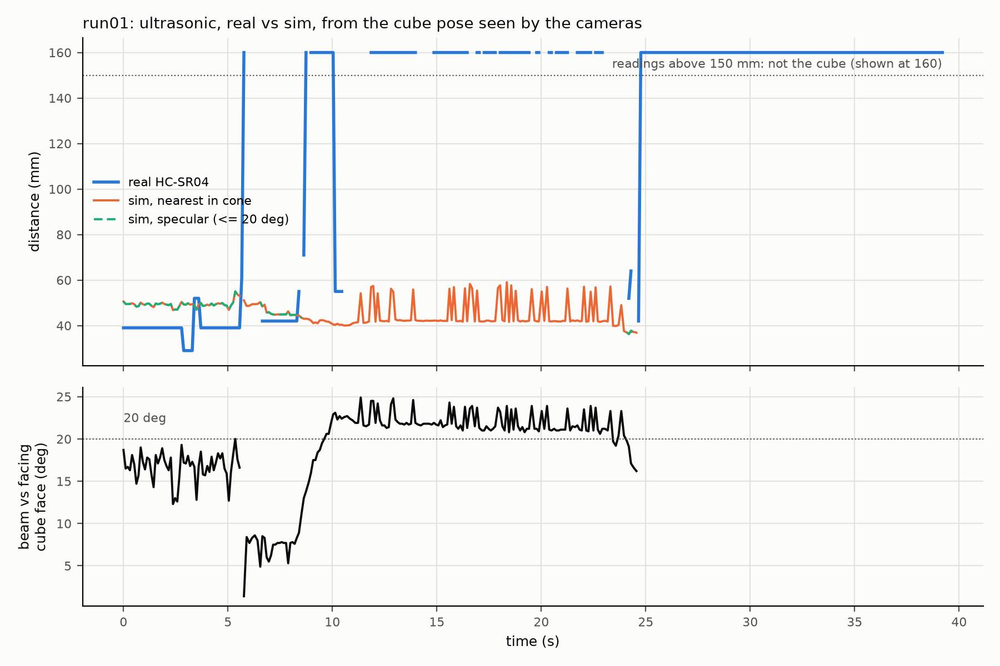

| sim 模型 | "能否测到方块"与真实一致 | 都测到时 sim − 真实 |
|---|---|---|
| 圆锥内最近距离 | 36%（80/223） | 中位数 +9.8 mm |
| **入射角 ≤ 20° 才有回波** | **94%（209/223）** | 中位数 +9.9 mm |

结论：

- 方块倾斜后（9–23 秒），正对传感器那一面与光束的夹角为 21–25°，真实传感器读到 640 mm 以外的墙或无回波，与用户的观察一致（面不平行时读数异常）。**入射角模型能复现这一点，最近距离模型不能。**
- 阈值没有被这次数据确定：倾斜阶段的夹角集中在 21–25°，能测到方块的阶段都 ≤ 20°。只用"正对面夹角 ≤ θ"判断，θ = 18° 时一致 86%，20° 时 88%，22° 时 50%。需要覆盖更多角度的数据。
- 距离偏差 +10 mm：这里方块位置来自两个相机的融合，x 方向有约 10 mm 的系统偏差（与 8.5 节两相机之间 5–10 mm 的不一致同源）；8.3 节直接用 side 画面测距时误差在 ±4 mm 内。

### 8.7 入射角阈值（angle01 / angle02）

方块放在手掌上，用手捏住方块远离传感器的一侧，绕竖直方向在 ±45° 之间慢慢来回转动，同步录 60 秒（`real2sim/ultrasonic/incidence_analysis.py`、`threshold_sweep.py`）。

- **angle01 作废**：方块离传感器太近（约 2 cm），大部分读数是盲区饱和值 17 / 20 mm（213 个），与角度无关。分析脚本现在自动排除读数 < 25 mm 的样本。
- **angle02**（方块在手掌远端，约 7 cm，真实读数中位数 74 mm，无盲区样本）：

| 正对面与光束夹角 | 真实传感器测到方块的比例 |
|---|---|
| 10–20° | 83% |
| 20–25° | 71% |
| 25–30° | 39% |
| 35–40° | 4% |

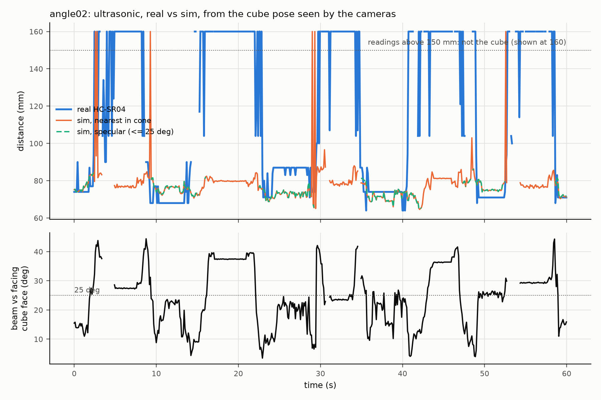

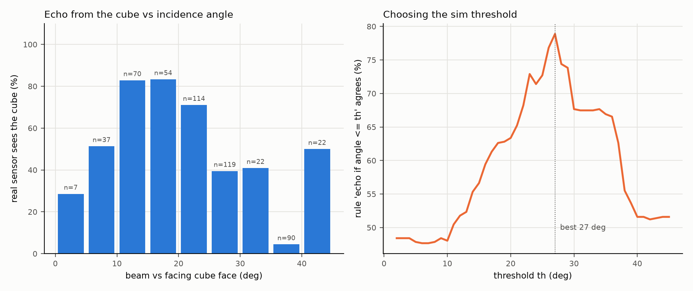

**sim 射线阈值的选择**（每条射线的入射角，盲区样本排除）：

| 阈值 | run01（约 4 cm） | angle02（约 7 cm） | 合计 |
|---|---|---|---|
| 15° | 94% | 63% | 72% |
| 20° | 95% | 75% | 81% |
| **25°** | 90% | **88%** | **88%** |
| 30° | 90% | 87% | 88% |
| 不限制（最近距离） | 36% | 51% | 46% |

- 采用 **25°**（`rig.yaml` 的 `ultrasonic.max_incidence_deg`），两组数据都在 88–91%。这是在这两组数据上选出来的（样本内），需要新数据验证。
- 用 25° 重新生成的数据表：run01 一致 91%（202/223），angle02 一致 88%（469/535）。都测到方块时，angle02 的 sim − 真实中位数 −0.1 mm、平均绝对误差 7.3 mm；run01（方块靠近手腕，约 4 cm）为 +9.8 mm，两相机融合的位置偏差在靠近手腕处更明显。

### 8.8 policy 回放 run02 与关节姿态检查（posecheck02）

**run02**：结尾改为先松开拇指、再收回其他手指，关节速度上限降到 40°/s，回放 38 秒。结果手指张得过开，方块掉了。检查轨迹发现：

- sim 里 policy 从"所有关节 0°"（手指伸直）开始，而真实手平时在中立位（手指微弯）；policy 还会把手指往反方向掰：ring_mcp 到 −24.7°（33% 时间在下限）、middle_mcp −17°、各 pip −14.6°。
- thumb_mcp 有 74% 的时间被截断在真实上限 40°（sim 要到 100°），拇指基本没有按 sim 的方式动。
- 放慢 13 倍后，policy 依赖的动态接触效果不复存在。
- 结论：即使关节标定完全准确，开环回放 sim 里的 policy 也很难复现操作，这本身是一个 sim2real 发现。

**关节姿态检查**（`real2sim/hand/pose_check.py`）：回放 6 个已知姿态（中立位、全 0°、四指 45°、拇指弯曲、手指张开、中立位），每个停 4 秒，手腕固定在中立位 −9.6°，同时录制；用帧间变化自动找到回放开始时刻（各段"静止—运动"对比最强处），再把 sim 手按完全相同的角度渲染、叠到两个相机的画面上。

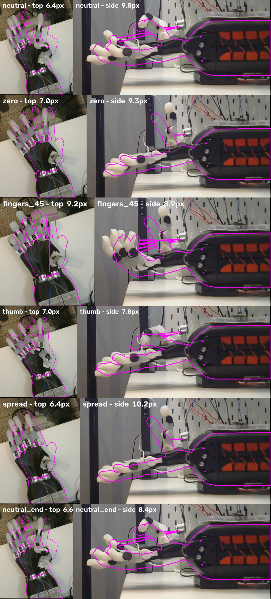

- **top 视角**：所有姿态下，sim 手都比真实手往拇指一侧偏、并转了一个角度（真实手指整体向小指方向偏约 10–15°），靠近手腕的手掌部分是对齐的。改变 sim 手腕角度（−19.2° 到 +9.6°）几乎不影响这个偏差（到真实边缘的距离 7.2 → 6.4 px），因为 sim 手腕关节是上下弯，不是左右偏。
- **side 视角**：sim 手腕关节让手上下弯。"全 0°"姿态下，sim 手腕取 0° 时与真实最吻合（8.0 px），取指令值 −9.6° 时更差（9.3 px）：同样的 −9.6° 指令，真实手腕只弯到相当于 sim 的 0°~−5°，手腕有约 5–10° 的偏差。
- 手指的上下弯曲（四指 45°）在 side 视角里大致对得上；拇指姿态偏差较大。
- 真实手的关节标定（orca_core `calibration.yaml`）最后更新于 2026-09-08。用户提到的 `orca_teleop-main` 里的 calibration 是遥操作用的双目相机标定和人手→机械手的重定向参数，不是关节标定。

**重新标定后（posecheck03）**：用户用 orca_core `calibrate.py` 依次重新标定了食指、中指、无名指、小指、拇指（手腕跳过，避免带动整只手和传感器；旧文件备份为 `calibration.before-recal-20261120.yaml`），再用同一个姿态检查文件录制。评分为 sim 手外轮廓到真实画面边缘（Canny）的中位距离：

| 姿态 | top 前 → 后 (px) | side 前 → 后 (px) |
|---|---|---|
| 中立位 | 6.4 → 7.0 | 9.0 → 8.4 |
| 全 0° | 7.0 → 6.2 | 9.3 → 8.2 |
| 四指 45° | 9.2 → 8.6 | 8.9 → 8.6 |
| 拇指弯曲 | 7.0 → 7.0 | 7.0 → 7.0 |
| 张开 | 6.4 → 6.0 | 10.2 → 9.2 |
| 中立位（结束） | 6.6 → 6.4 | 8.4 → 8.0 |
| **平均** | **7.1 → 6.9** | **8.8 → 8.2** |

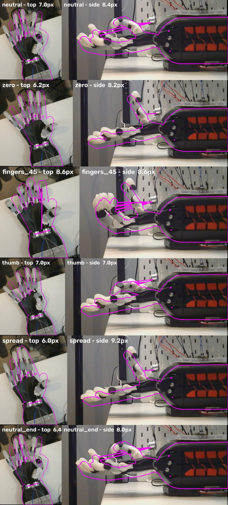

- 重新标定只带来小幅改善（top −3%，side −7%）。
- top 视角最明显的残余偏差集中在**小指和无名指**："全 0°"和"张开"姿态下，真实的小指、无名指比 sim 更向外偏，食指、中指基本对齐。重新标定没有消除它，可能是这两个外展关节的零点偏差，或模型与实物的几何差异。
- 评分方法的局限：Canny 边缘也包括背景，评分只能反映大致趋势。

**外展关节检查（abdcheck01）**：食指、无名指、小指的外展关节依次停在 −20° / +20°，中间回到 0°，其他关节为 0°（`pose_check.py make abd`）。

- 自动拟合（每根手指单独扫描 −30°~+30° 的修正量，最小化该手指轮廓到真实边缘的距离）**不可信**：多个结果落在扫描边界上，而且小指结果显示"无论指令多少都停在 +6°"，与画面中明显的运动矛盾。原因是相邻手指外形相似，轮廓会贴到旁边手指的边缘上。
- 改为直接画图判断：在同一张真实画面上画出 sim 在 −20° / 0° / +20° 时该手指的轮廓。

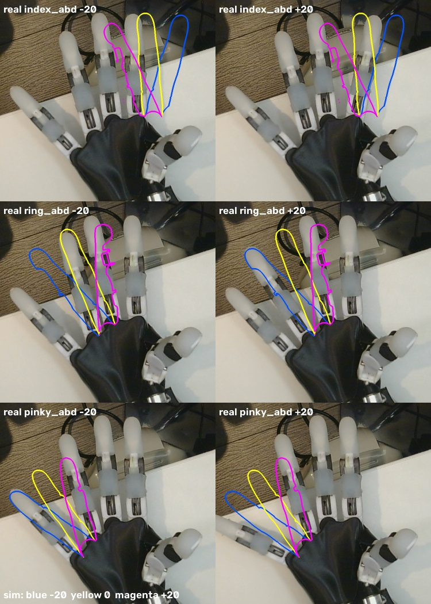

- **无名指和小指的外展方向在 sim 和真实手上相反**：sim 里 + 方向是往里收（朝中指），真实手里指令从 −20° 变到 +20° 时手指往外张。`sim_to_real.py` 已经为 index_abd 做了同样的符号翻转（"index_abd is defined with the opposite sign"），但 ring_abd、pinky_abd 没有。
- 另外真实的"0°"比 sim 的 0° 更往外张。按 `sim = −指令 + 偏移` 画图比较：

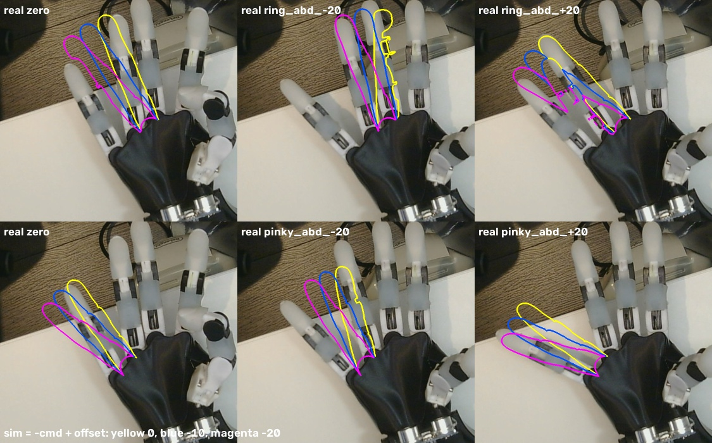

- 无名指偏移约 −20°、小指约 −25°~−30° 时最贴合（目测，误差约 ±5–10°）；小指在指令 +20° 时已接近 sim 的行程极限 −30°。
- 结论：top 视角中残余的偏差主要来自这两个关节的**符号相反 + 零点偏移**，重新标定无法消除，需要在 sim↔真实的关节映射里修正。

**修正与验证（abdcheck03）**：`real2sim/hand/joint_map.py` 对 ring_abd、pinky_abd 使用 `sim = −指令 + 偏移`（偏移分别为 −20°、−27°），其余关节沿用 `sim_to_real.py`（index_abd 取负）。按修正后的映射，以 sim 角度为目标生成检查文件（无名指 sim −25° / −10° / +5°，小指 −28° / −15° / 0°；真实行程限制了能验证的范围），重新录制并对比：

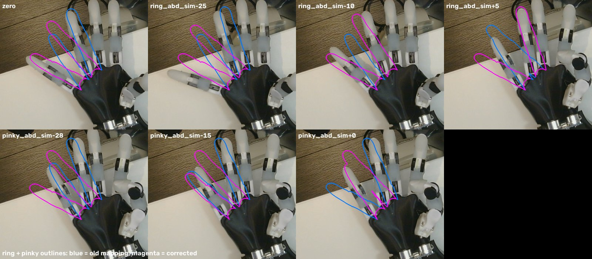

- 修正后的轮廓在"全 0°"、小指 sim 0° 等姿态下贴合真实手指；旧映射预测的小指张得接近水平，真实小指则较竖直。其余姿态修正后也更接近，仍有几度偏差。
- 偏移量是在 abdcheck01 上估计的，在独立录制 abdcheck03 上成立。整手评分（6–9 px）对单根手指不敏感，所以这里用画图判断。
- 修正后的映射也揭示了一个限制：sim 里小指外展在 0° 附近时，真实小指需要往里收到约 −27°，接近真实行程极限 −30°，真实小指往里收的余量比 sim 小。

### 8.9 采集注意事项

- 一个相机或串口同时只能被一个程序打开；预览窗口或串口监视器没关时，采集会卡住。
- 不要大幅移动手腕：手和装在前臂塔上的传感器都会跟着移动，相机外参和传感器位置就会失效。

## 9. 复现步骤（命令）

```bash
# 0. 打印标定板（Letter，100%），贴到硬板上，量 100 mm 检查条和格子总长
python real2sim/cameras/make_targets.py

# 1. 内参（每个相机一次；整块棋盘入画、覆盖四角四边、倾斜 30–45°、手动按 SPACE）
python real2sim/cameras/capture.py intr_top  --cams top
python real2sim/cameras/capture.py intr_side --cams side
python real2sim/cameras/calibrate_intrinsics.py intr_top  --cam top
python real2sim/cameras/calibrate_intrinsics.py intr_side --cam side

# 2. 外参：top 棋盘平放（量 D、B），side 棋盘贴塔立起（量 a、M），数值写进 rig.yaml
python real2sim/cameras/capture.py extr_top  --cams top
python real2sim/cameras/capture.py extr_side --cams side
python real2sim/cameras/calibrate_extrinsics.py --cam-session top=extr_top --cam-session side=extr_side

# 2b.（如果相机拍完后被轻微碰到）
python real2sim/cameras/correct_bump.py top real2sim/data/extr_top/top/008.png real2sim/data/extr_top/after_bump.png

# 3. 检查 & 生成本文的图
python real2sim/cameras/show_scene.py --calibrated
cd real2sim/cameras && python make_figures.py
```
