# Dual-camera and ultrasonic real2sim for the ORCA hand (SEP 730, Joe's part)

Dates: 2026-11-18 to 2026-11-21. Branch `real2sim-cameras`.
Chinese version: `docs/real2sim_camera_calibration.md` (same content, same figures).

Goal: put the two real cameras on the bench (Logitech Brio 100: `top` looking down, `side` looking from the pinky side) and the HC-SR04 ultrasonic sensor into the MuJoCo scene, so that the sim renders and the sim sensor agree geometrically with the real ones, and record synchronized data of the real hand manipulating a cube with the trained policy.

Deliverables:

| File | Content |
|---|---|
| `real2sim/cameras/calib/top_intrinsics.json`, `side_intrinsics.json` | intrinsics K and distortion coefficients |
| `real2sim/cameras/calib/cameras.json` | both camera poses in the sim world frame (incl. MuJoCo `xyaxes`), intrinsics, per-step statistics |
| `src/orca_sim/scenes/v2/scene_right_cube_orientation_real2sim.xml` | cube task scene + the two calibrated cameras + the real bench + the ultrasonic sensor |
| `real2sim/cameras/rig.yaml` | every bench measurement and how it is converted (in the comments) |
| `real2sim/hand/joint_map.py` | real (orca_core) ↔ sim joint mapping, with the corrections measured on this bench |
| `real2sim/dataset_package/` (+ `.zip`) | synchronized CSV datasets for teammates (README inside) |
| `docs/figures/real2sim/` | all figures of this document |

---

## 0. Paper summary (key results and claims)

**What was built**

1. A camera digital twin: two calibrated real cameras reproduced in MuJoCo with their real intrinsics and poses. The sim hand overlaps the real hand to about 10–20 px (≈ 3–5 mm) in both views (Section 7).
2. An ultrasonic digital twin: an HC-SR04 located with the cameras (not a ruler) and modelled as a 15° cone of 25 rangefinder rays, a calibrated range offset (+2.9 mm), a 20 mm dead zone and a specular incidence limit (25°). Static distance error ±4 mm, held-out error +3.9 mm (Section 8.3); with the cube still on the palm sim − real median +0.7 mm, MAE 5.9 mm (Section 8.15).
3. A synchronized recorder (two cameras + ultrasonic on one host clock, ≤ 1 frame skew after measured latency offsets) and an AprilTag cube for per-frame 6-DoF cube pose (≈ 5–10 mm, 3–5°) (Sections 8.4–8.5).
4. A full digital twin of policy replays: the sim hand follows the exact commanded joint angles (time-logged replay), the sim cube follows the camera pose, and the sim ultrasonic is compared with the real one sample by sample, including which body the echo comes from (Sections 8.9–8.17).
5. Joint-level real2sim checks of the hand from the camera overlays, which found sign and zero errors in the ring/pinky abduction mapping, and that a hand recalibration changes them again (Sections 8.8, 8.16).

**Key numbers**

| Quantity | Value |
|---|---|
| Intrinsics RMS reprojection | top 0.675 px, side 0.587 px |
| Camera pose repeatability (two independent setups) | ≈ 5 mm |
| Sim vs real hand (rigid parts) | 10–20 px ≈ 3–5 mm |
| Ultrasonic sensor location (cameras) | transducer spacing 26.4 mm (spec 26 mm) |
| Ultrasonic static, positions 2–5 | MAE 3.3 mm, RMS 3.9 mm (in-sample); held-out +3.9 mm |
| Echo/no-echo agreement, nearest-hit vs 25° specular model | 46% vs 88% (run01 + angle02) |
| Stream timing (event test) | top +9 ms, side −27 ms vs ultrasonic; ultrasonic sampling limits timing to ±50 ms |
| Cube static check (static01) | sim − real median +0.7 mm, MAE 5.9 mm |
| Full twin during policy replay, run07 / run08 | agreement 78% / 79%; twin − real median +6.9 / +6.3 mm; MAE 9.9 / 7.3 mm |
| Cube turned by the open-loop policy, run07 → run08 (after the mapping fix) | 23° → 124° |

**Findings worth reporting (sim2real lessons)**

- A low calibration RMS does not mean correct intrinsics: with incomplete coverage the side camera had RMS 0.46 px but fx 57% off (Section 2.1).
- AprilTag corners are detected about 2.8% inside the printed square at 90–130 px tag size; using an effective tag size (26.25 mm instead of 27 mm) cut the disagreement between the two cameras from 23.5 to 10 mm (Section 8.5).
- The real ultrasonic echo depends on the incidence angle; a nearest-hit cone model gets echo/no-echo right only 36–51% of the time, an incidence limit raises it to 88–95% (Sections 8.6–8.7). The best limit grows with distance, consistent with the separate transmitter and receiver of the HC-SR04 (Section 8.11).
- The sensor only rests on the palm base and moves with the wrist (correlation 0.86 / 0.88), so the ultrasonic twin is only valid with the wrist locked (Section 8.12).
- The ring and pinky abduction joints ran opposite to the sim and had zero offsets of 20–27°; after the user re-ran the orca_core calibration they ran the sim's way again with offsets of 10–14°. Joint mapping must be re-checked after every hand calibration (Sections 8.8, 8.16).
- Open-loop replay of the sim policy on the real hand does not reproduce the manipulation (the cube is turned but always dropped): the policy cannot react to the real cube, its motion is slowed 12× for safety, and joint ranges are clamped (Sections 8.8, 8.17).

**Limitations**

- The camera pose relies on tape measurements of the board relative to the forearm tower (±1–2 mm, ±1–2°); no independent held-out check of the camera pose yet.
- The ultrasonic model is a monostatic cone with an incidence threshold; a bistatic (separate transmitter/receiver) model is the next step.
- Finger joint agreement is judged by eye from overlays (automatic edge scores could not separate good from bad poses).
- Policy replays are open loop.

---

## 1. Method overview

Going from a real camera to a sim camera needs two sets of parameters:

1. **Intrinsics** (focal lengths fx, fy; principal point cx, cy; lens distortion k1 k2 p1 p2 k3): depend only on the lens; estimated from many photos of a calibration board.
2. **Extrinsics** (camera position and orientation in the sim world frame): the sim world frame is defined by the hand, so the extrinsics must go through an object whose position relative to the hand is known.

The extrinsic chain is:

```
T_world_cam = T_world_board · T_board_cam
               (measured: board relative to the hand)   (image: solvePnP, < 1 mm)
```

`T_board_cam` comes from the images automatically and is very accurate; `T_world_board` comes from tape measurements of the board relative to the hand's forearm tower and is the main error source.

### 1.1 Conventions

- Sim scene `scene_right_cube_orientation.xml`: the hand is mounted at (0, 0, 0.16), fingers point +x, palm faces +z, thumb on the −y side.
- Forearm tower (black forearm block; bodies `ForeArmStructure` + `TopTower` in the sim): x −0.058…0.099, y −0.057…0.037, z 0.112…0.208 (m).
  - **Front face** x = 0.099 (the face of the tower towards the fingers; on the real hand right at the finger side of the ultrasonic sensor).
  - **Pinky-side face** y = 0.037.
  - Check: sim tower width 94 mm, real tower measured 93 mm.
- OpenCV camera frame (x right, y down, z forward) → MuJoCo camera frame (x right, y up, looking along −z): `R_mj = R_cv · diag(1, −1, −1)`; the MuJoCo `xyaxes` are the first two columns of `R_mj`.
- MuJoCo 3.x cameras with real intrinsics: `resolution="W H"`, `sensorsize`, `focalpixel="fx fy"`, `principalpixel="W/2−(cx+0.5)  H/2−(cy+0.5)"`.
  `principalpixel` is an offset from the image centre and there is a 0.5 px pixel-centre convention difference; the formula was verified on synthetic data, principal point error < 0.1 px (19.5 px with the wrong sign at first).

### 1.2 Calibration board

- ChArUco board: 7 × 5 squares, 35 mm squares, 26 mm ArUco markers, dictionary DICT_5X5_100 (the cube uses AprilTag 36h11, so they cannot be confused).
- Generated with `make_targets.py`, printed on US Letter at 100%, glued to a 4.53 mm rigid board.
- **Print size check**: 100 mm check bar = 100 mm; 7 squares = 245.0 mm (35.00 mm/square), 5 squares = 174.5 mm (34.90 mm/square), within ruler reading error, so `square_mm` stays 35.0.
- ChArUco vs a plain chessboard: every corner has an id, so partially visible boards still work, which matters for covering the image corners.

### 1.3 Synthetic validation (validate the code before the real bench)

`tests/test_real2sim_cameras.py` lets MuJoCo play the "real camera": a camera with known intrinsics, distortion and pose photographs the board, and the whole pipeline must recover them from the images.

| Item | Truth | Recovered |
|---|---|---|
| fx (top) | 1000 | 998 |
| k1 (top) | −0.08 | −0.085 |
| top position / orientation error | – | 3.37 mm / 0.293° |
| side position / orientation error | – | 0.48 mm / 0.055° |
| sim vs "real" corner overlap (incl. new positions not used for calibration) | – | 0.05–0.11 px |

Conclusion: the code's own error is far below the error of the real measurements.

---

## 2. Intrinsic calibration

Tools: `capture.py <session>` (both previews side by side, SPACE saves) → `calibrate_intrinsics.py <session> --cam X` (`cv2.calibrateCamera`, drops photos with reprojection error > 3× the median, prints a 3×4 corner coverage table).

### 2.1 Process and lessons (material for a "practical lessons" paragraph)

The intrinsics took four rounds; each round's problem is typical:

| Round | Result | Problem | How it was diagnosed |
|---|---|---|---|
| 1 | top fx 1362, side fx 2141, k3 = 24.9 | incomplete coverage: no corners in the right half of top; side leftmost column and bottom row empty | coverage table; two identical cameras with fx 57% apart, implausible k3 |
| 2 | top fx 1762, side fx 1962 | side had 70 nearly identical photos (auto-save while the board was still); 20 too close and out of focus (sharpness ~13 vs ~40 normally) | per-photo corner positions and Laplacian sharpness (Fig. A1) |
| 3 | side RMS 0.91 px | paper not glued flat, board wavy | bent grid lines in the photos (Fig. A2) |
| 4 | side RMS 0.55 px, bottom row coverage 0 | side camera almost on the bench; a board standing on the bench always stops at the bench line y≈560 | max corner y ≈ 560 in every photo (Fig. A3) |
| 4+ | 16 extra side photos (camera raised temporarily), RMS 0.59 px, all 12 cells covered | accepted | – |

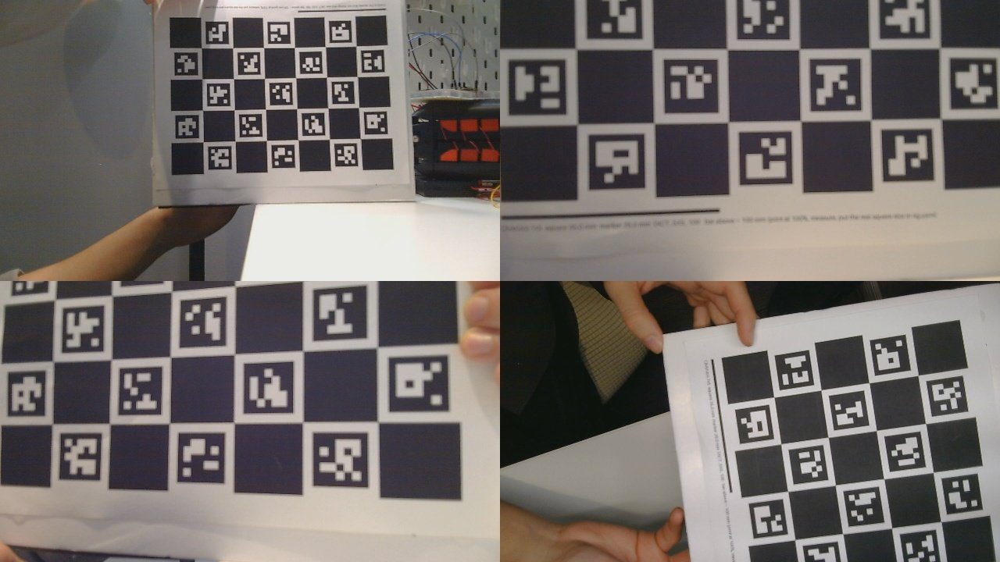

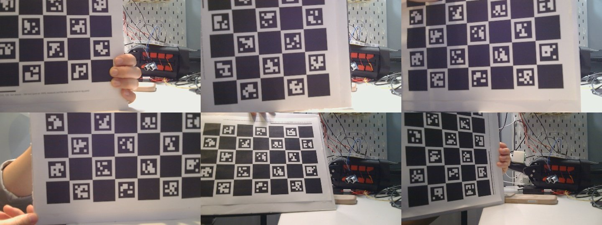

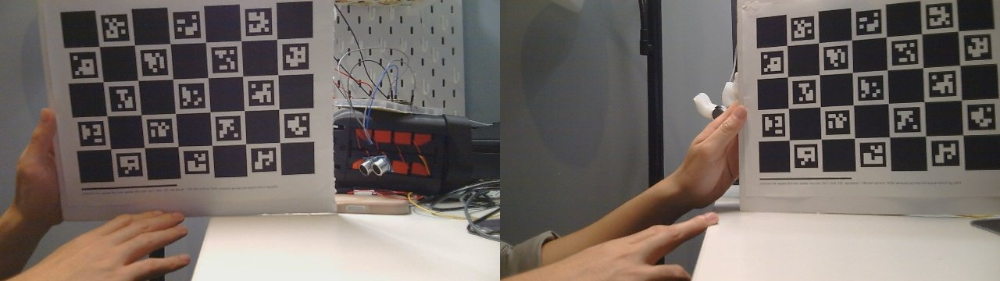

Takeaways:

- **A small RMS does not mean a correct result.** In round 1 the side RMS was only 0.46 px but fx was 57% off: with incomplete coverage the solver can fit the central region with a wrong focal length and exaggerated distortion.
- **Cross-checking identical cameras** works well: the two Brio 100 should have similar fx; also check against the spec (Brio 100 diagonal FOV 58°, fx ≈ 1987 at 1920×1080).
- A fixed-focus camera (Brio 100) blurs when too close; the board must be fully in view and fill 1/4–1/2 of the image width.
- Intrinsics do not depend on where the camera stands, so the camera can be moved temporarily to cover regions that are otherwise unreachable.

### 2.2 Final intrinsics (1920 × 1080)

| | top | side |
|---|---|---|
| photos | 32 | 43 |
| RMS reprojection | 0.675 px | 0.587 px |
| fx, fy | 1960.11, 1956.53 | 1935.71, 1931.20 |
| cx, cy | 981.47, 525.55 | 945.93, 502.02 |
| FOV horizontal / vertical | 52.2° / 30.9° | 52.8° / 31.2° |
| k1, k2 | 0.1728, −0.8304 | 0.1739, −0.7092 |
| p1, p2 | 0.0019, 0.0006 | 0.0008, 0.0007 |
| k3 | 1.1616 | 0.4968 |

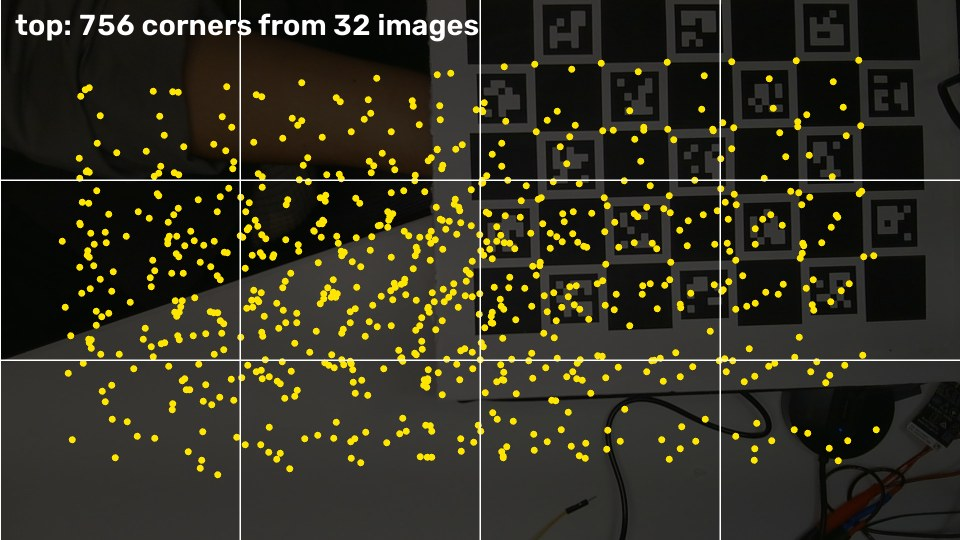
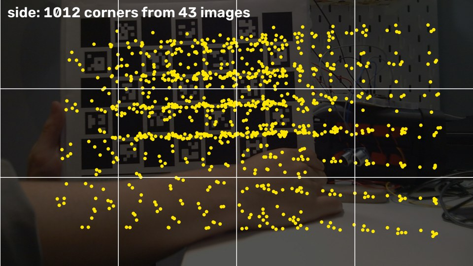

- The top RMS of 0.675 px is a little above the 0.5 px rule of thumb. Per-photo errors are 0.39–1.03 px, evenly spread with no outlier; removing any photo does not help noticeably. Likely hand shake and MJPG compression. At 50 cm this is about 0.17 mm, acceptable.
- The two cameras' fx differ by 1.3% with similar distortion: unit-to-unit variation of the same model, which cross-validates the result.
- MuJoCo renders undistorted pinhole images, so real frames must be `cv2.undistort(img, K, dist)` before comparing with the sim or feeding a sim-trained policy.

---

## 3. Camera placement

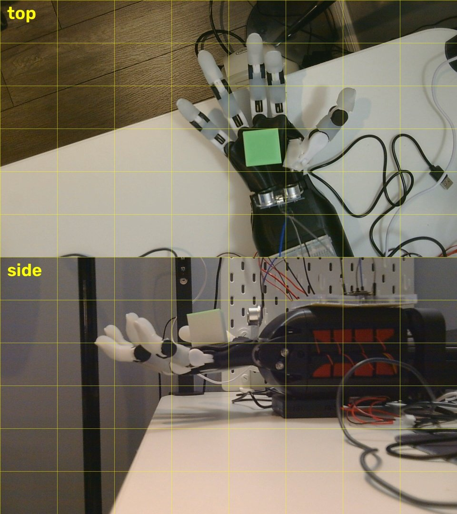

- top: almost straight down; the whole hand and the cube's range are in view, fingertips about 140 px from the top edge.
- side: looking from the pinky side, about 54 cm away, about 5 cm above the bench.
- After the extrinsics are taken, neither the cameras nor the hand may move (this went wrong twice in practice, Sections 4.3 and 5.2).

---

## 4. Top camera extrinsics

### 4.1 Board placement and measurements

- The board lies **flat** on the pinky side of the hand; its long edge is held against the tower's pinky-side face with a ruler to keep it parallel.
- The top camera sees 24/24 corners (Fig. C2).

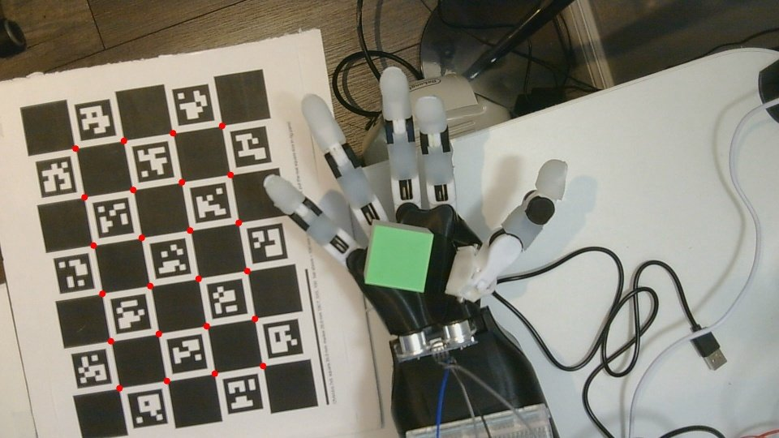

Measurements (Fig. C3 marks the two reference faces):

- **H**: tower bottom above the bench = 20 mm → the bench is at z = 0.112 − 0.020 = **0.092** in the sim.
- **T**: board thickness = 4.53 mm.
- **D**: tower front face (red) → far edge (fingertip side) of the printed grid, along the fingers.
- **B**: tower pinky-side face (blue) → nearest edge of the printed grid, across the fingers.

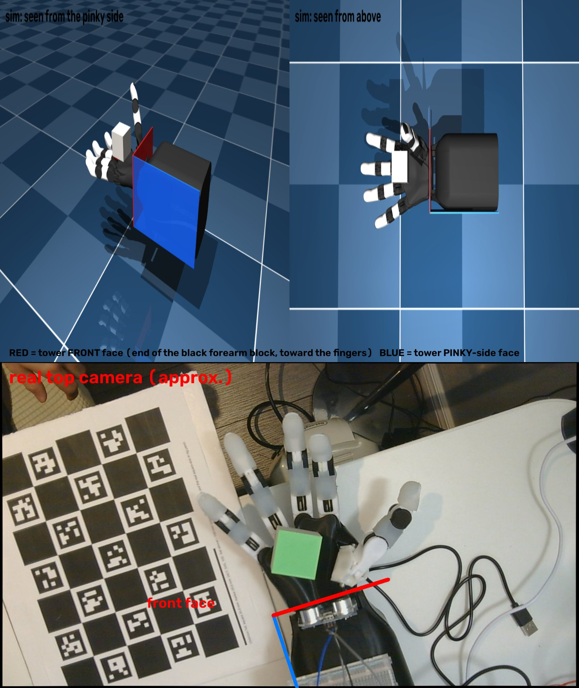

Conversion (board 245 × 175 mm, half length 0.1225, half width 0.0875):

```
centre x = 0.099 + D − 0.1225
centre y = 0.037 + B + 0.0875
centre z = 0.092 + T
```

### 4.2 First measurement (D = 201 mm, B = 55 mm)

- Camera at (0.197, −0.019, 0.663) m; 0.9 mm / 0.09° spread over 5 frames.
- Rendering the sim hand with this pose and overlaying it on the real image, the rigid forearm tower is off by about 10–20 px (≈ 3–5 mm).

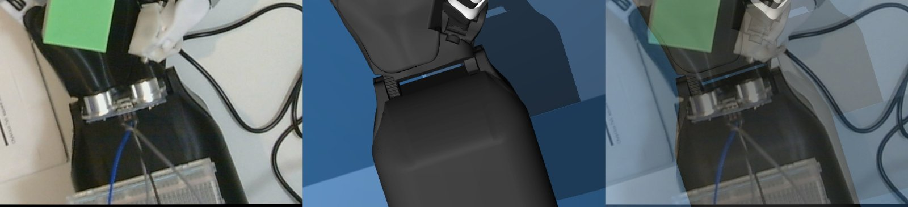

**Automatic correction tried and rejected**: maximise the IoU of the dark-pixel silhouette in the tower region over (dx, dy, dyaw). IoU rose from 0.534 to 0.604, but the optimum dx = +8 mm sat on the search boundary, i.e. it was fitting noise: the real tower carries a breadboard and cables and the black shell reflects, so the silhouette is not clean. Not used.

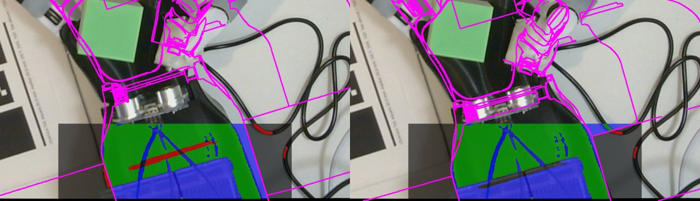

### 4.3 Re-measured after the hand was moved (D = 209 mm, B = 50 mm)

The hand had been moved, so the top extrinsics had to be redone (the sim frame moves with the hand; the camera itself did not move).

- Two surprises, both caught by checking the results:
  1. Five old photos from before the move were mixed into the folder → 216 mm spread over 9 frames. Normal after removing them.
  2. The board was placed the other way round (100 mm bar facing out) → camera at y = 0.363 and the sim hand completely out of view. Fixed by setting `yaw` to 180° from the photos. **No retake needed**, only the configured orientation was wrong.
- Final: camera at **(0.197, −0.014, 0.664) m**, 4 frames, reprojection 0.42 px, 0.46 mm / 0.045° between frames.
- **Repeatability**: two independent placements and measurements give camera positions about 5 mm apart (−0.019 vs −0.014), i.e. the tape measurement is good to about 5 mm.

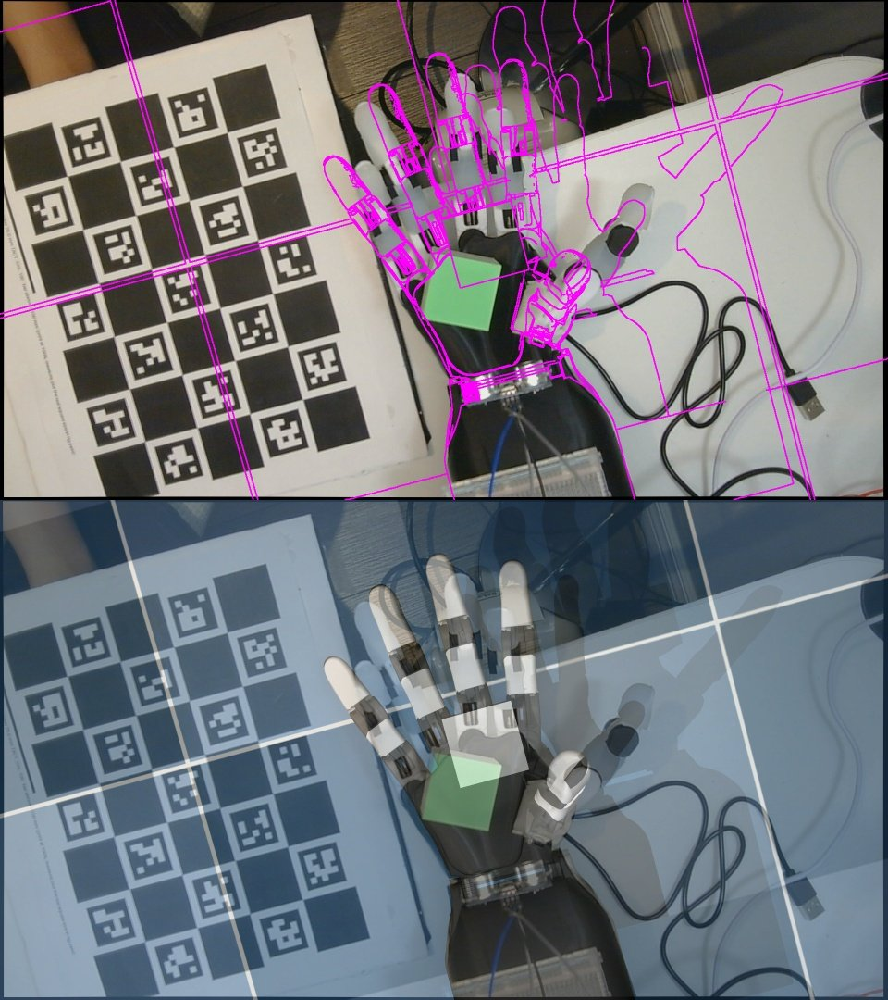

### 4.4 Correcting a small bump of the top camera

The top camera was bumped after the extrinsic photos. Fixed with `correct_bump.py` instead of retaking:

- ORB feature matches between an extrinsic photo and a new photo after the bump (static background): 356 matches.
- A clamped camera that gets bumped mainly rotates about itself, so a **pure rotation** is fitted to the two sets of viewing rays (SVD): **0.171°**, median residual **0.93 px**. The small residual confirms the pure-rotation assumption; if the camera had also translated, the residual would be several pixels and the tool refuses and asks for a retake.
- 0.17° is about 1.5 mm at the hand.

---

## 5. Side camera extrinsics

### 5.1 Approaches tried and rejected

1. **Board standing between the hand and the side camera, position measured and angles aligned by hand**: aligning vertical and parallel by hand is too hard, large error.
2. **Both cameras see one tilted board** (the board's world pose from the calibrated top camera, nothing to measure for the side camera; implemented as `calibrate_extrinsics.py --via side=top:SESSION`): better in theory, but the side camera is only about 30 cm from the hand and one camera always sees the tilted board only partly (Fig. E1). Abandoned.

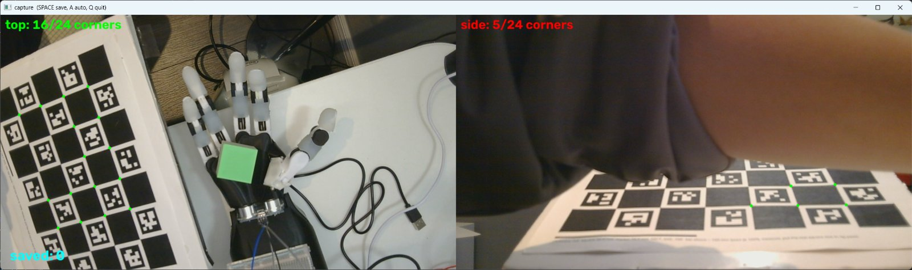

### 5.2 Final approach: board standing against the tower

- The board stands on the bench with its **back pressed against the tower's pinky-side face**, printed side towards the side camera, bar at the bottom (Fig. E2). **Vertical and parallel are then automatic**, and only two short distances are measured:
  - **a** = 130 mm: tower front face → fingertip-side edge of the printed grid.
  - **M** = 45 mm: bench → bottom edge of the printed grid.
- The side camera was bumped in between; old photos deleted and retaken; the side camera moved back to about 54 cm.

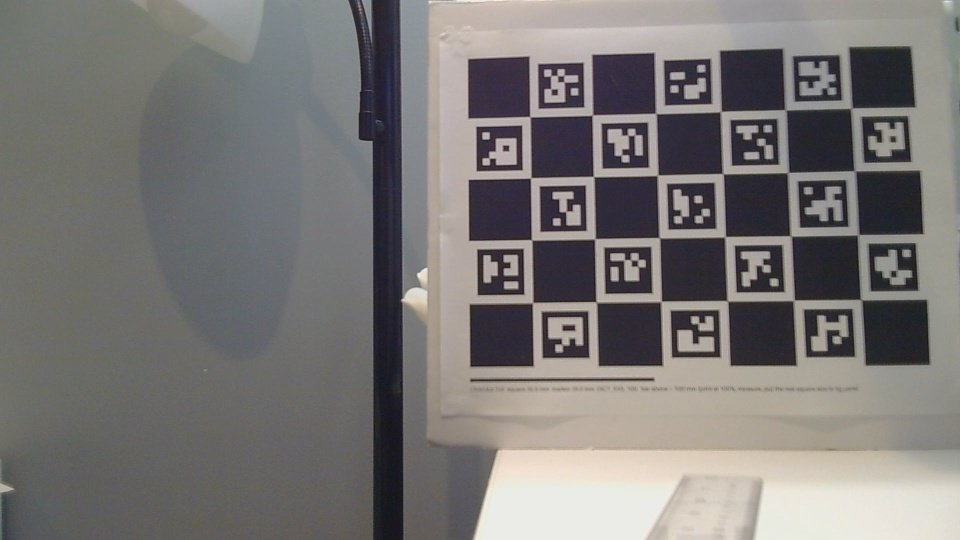

Conversion (board facing +y, upright: `yaw = 180°, tilt = 90°`):

```
centre x     = 0.099 + a − 0.1225 = 0.1065
printed face y = 0.037 + T        = 0.0415
centre z     = 0.092 + M + 0.0875 = 0.2245
```

Result: camera at **(0.190, 0.578, 0.140) m**, looking along (0.068, −0.991, 0.113), 5 frames, reprojection 0.53 px, 1.66 mm / 0.164° between frames.

---

## 6. Sim scene addition: the real bench

The overlay showed two "ghosts" in the top view (Fig. F1), because:

- the sim scene has two shadow-casting lights, so the hand casts two shadows on the floor;
- the sim floor is at z = 0, 92 mm below the real bench, and the oblique light puts the shadows far from the hand.

With shadows off the ghosts disappear (Fig. F2), so this is unrelated to the camera calibration.

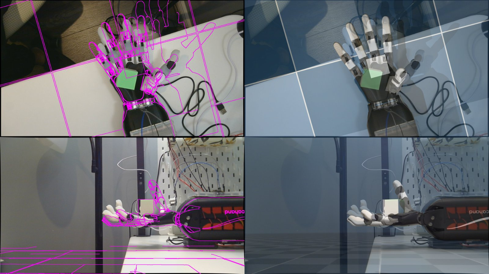
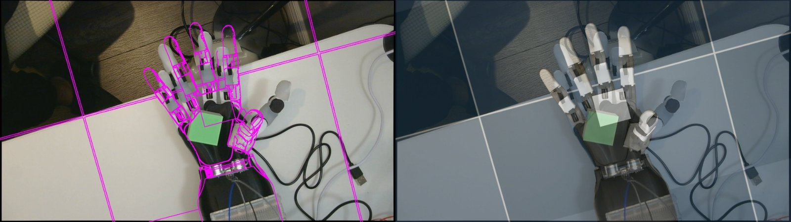

Fix: the `_real2sim` scene gets a bench with its top at z = 0.092 (`bench` in `rig.yaml`); **the training scene is unchanged** (the training env detects a drop with `z < 0.05`; changing its floor would break that). Check: a cube dropped next to the hand comes to rest at z = 0.1108 (expected 0.092 + 0.018 = 0.110); in the side view the sim bench edge coincides with the real one (Fig. F3).

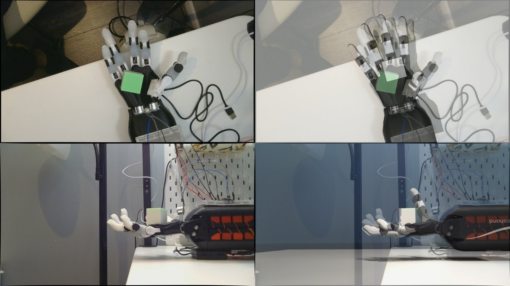

Note: when running the task environment on the `_real2sim` scene, `drop_height` must be raised to about 0.13.

---

## 7. Final camera result

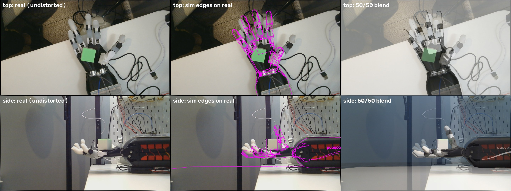

| | top | side |
|---|---|---|
| position (m) | (0.197, −0.014, 0.664) | (0.190, 0.578, 0.140) |
| extrinsic reprojection | 0.42 px | 0.53 px |
| frame-to-frame consistency | 0.46 mm / 0.045° | 1.66 mm / 0.164° |
| sim vs real hand (by eye, rigid parts) | 10–20 px (3–5 mm) | 10–20 px (3–5 mm) |

- Matches: forearm tower, wrist, ultrasonic sensor, palm position; the bench in the side view.
- Does not match but unrelated to calibration: the fingers (sim joints at their default angles, the real hand in another pose; driving the sim joints with the real servo angles aligns them, Section 8.8).

### 7.1 Error sources and budget

| Source | Size |
|---|---|
| camera relative to the board (solvePnP, multi-frame mean) | < 1 mm, < 0.2° |
| intrinsics | 0.6–0.7 px RMS ≈ 0.2 mm at 50 cm |
| board relative to the hand (tape + visual alignment) | ±1–2 mm, ±1–2°, dominant |
| top bump correction | 0.17°, residual 0.9 px |
| sim model vs real hand | tower width 94 vs 93 mm |
| **total (repeatability of two independent setups)** | **≈ 5 mm** |

### 7.2 Limitations and next steps

- No quantitative held-out check yet (board at a new measured position, corner error). `overlay.py` supports it.
- Only the rigid parts (tower, wrist) are used to check the cameras.
- Higher accuracy: a marker at a known position on the forearm tower would remove the tape measurement.
- The real bench ends in front of the fingertips; the sim bench does not model that edge.
- If a camera or the hand moves, redo the extrinsics (not the intrinsics). Small bumps can be fixed with `correct_bump.py`.

---

## 8. Ultrasonic digital twin and policy replays (2026-11-20/21)

- The HC-SR04 is driven by an ESP32-S3 (`ORCA Ultra Sonic/src/main.cpp`, TRIG 10 / ECHO 18, one measurement every 100 ms, prints `Distance: xx.x cm`) on COM4 (FTDI); the hand's servo adapter is on COM3.
- `hardware/ultrasonic/read_ultrasonic.py` finds the port by listening for distance lines; it never writes to any port.
- The sensor sits in a clear holder, transducers at the height of the middle of a cube on the palm, facing the near face of the cube (the user confirmed the reading is the distance to the cube surface). **It only rests on the palm base and cannot be fixed** (Section 8.12).

### 8.1 Sensor location (with the cameras, not a ruler)

- Both transducer front faces are visible in the top image, the +y one also in the side image (correspondence confirmed with the epipolar line of the top ray in the side image). The +y transducer is triangulated with both cameras; the −y one is the top ray intersected with the same height.
- Result: transducer spacing **26.4 mm** (HC-SR04 spec 26 mm), centre (0.1069, −0.0107, 0.2010) m, pointing horizontally at −15.2° (perpendicular to the transducer line, towards the fingers). Height comes from the nearly level side camera; the nearly straight-down top camera gives only the horizontal position.
- Written to `ultrasonic` in `rig.yaml` and generated into the `_real2sim` scene.

### 8.2 Sim sensor model

- A real HC-SR04 returns the nearest echo within a cone (≈ 15° half angle), so the sim uses 25 rangefinder rays in a cone (axis + 3 rings × 8) and reports the nearest hit.
- With a single ray the sim ray misses the cube entirely; a 7.5° cone reads 41.7 mm, a 15° cone 28.4 mm. The cone is necessary.
- Tool: `real2sim/ultrasonic/twin_check.py` (locate the sensor, estimate the real cube pose with the cameras, compare sim and real readings).

### 8.3 Distance experiment (cube face parallel to the sensor)

At each position both cameras are captured and the sensor is read (median). "Camera" is the horizontal distance from the transducer front face to the near cube face, measured in the side image at the sensor height (reference); "sim" is the reading with the 35 mm cube placed in the sim at the camera-estimated pose.

Sorted by distance (position numbers are capture order; mm):

| Pos. | Cube at | Camera (ref.) | Real sensor | Sim geometric | Sim calibrated | Sim − real |
|---|---|---|---|---|---|---|
| 1 | near the wrist | 4.6 | 20.0 (constant) | 5.3 | 20.0 | 0.0 |
| 2 | mid palm | 27.0 | 33.0 | 23.9 | 26.8 | −6.2 |
| 4 | ≈ 4 cm | 42.2 | 39.0 | 40.0 | 42.9 | +3.9 |
| 3 | far palm | 61.4 | 61.0 | 57.8 | 60.7 | −0.3 |
| 5 | on the middle finger's 2nd joint | 77.1 | 80.0 | 74.4 | 77.3 | −2.7 |
| **6 (held out)** | ≈ 5 cm, new position | 54.0 | 52.0 | 53.0 | 55.9 | **+3.9** |

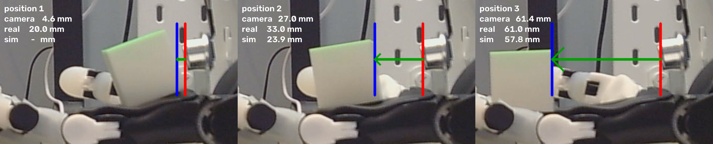

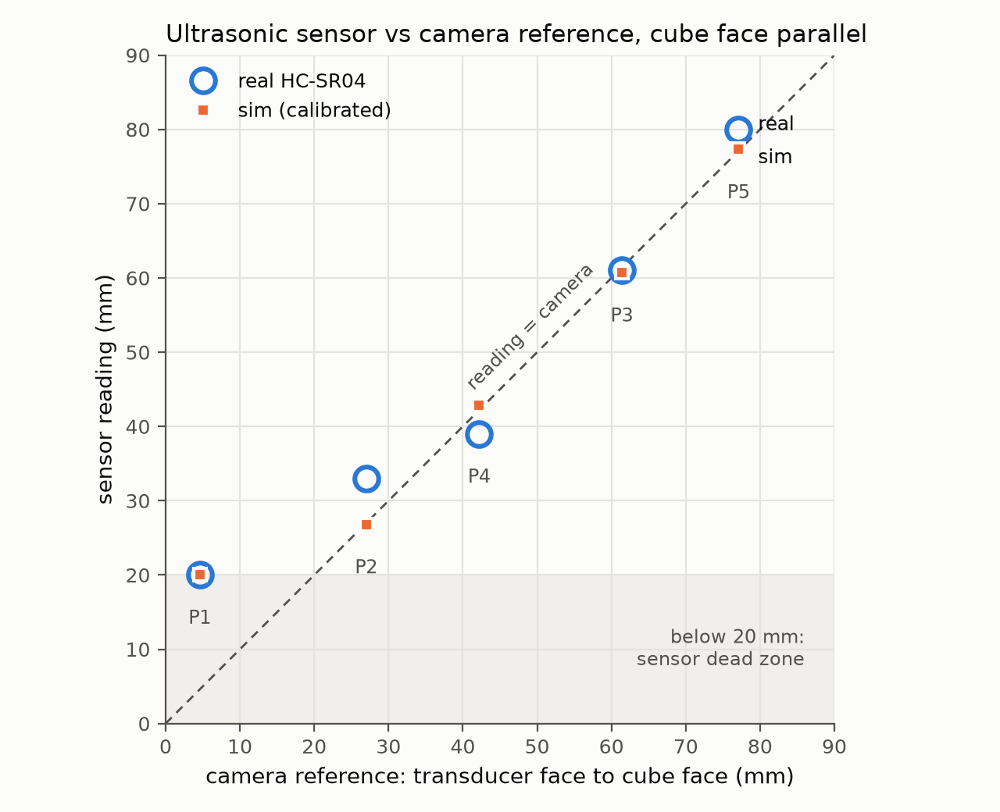

Conclusions:

- **Real sensor** (positions 2–5): linear fit reading = 0.97 × camera + 3.1 mm, residuals ≈ ±4 mm, no clear offset or scale error; this spread matches the error of the camera reference itself (edge picking ±1.5 mm, camera extrinsics ≈ 3–5 mm). Below 2 cm it is in the dead zone and reads 20 mm.
- **Sim geometric distance**: consistently **2.9 ± 0.6 mm** shorter than the camera reference (positions 2–5), a constant bias: 0.5 mm from the sim cube (36 mm) being larger than the real one (35 mm), the rest from a small inconsistency between the top and side cameras (cube horizontal position from top, reference from side). At position 1 the geometric 5.3 mm agrees with the camera's 4.6 mm.
- **Calibrated sim sensor**: reading = max(nearest hit in the cone + 2.9 mm, 20 mm), parameters in `rig.yaml` (`range_offset_m`, `min_range_m`). Against the real sensor: same dead zone; positions 2–5 MAE 3.3 mm, RMS 3.9 mm (in-sample: the offset was calibrated on these 4 points).
- **Held-out check**: with the parameters fixed, a new position (6, ≈ 5 cm): sim 55.9 mm, real 52.0 mm, error **+3.9 mm**, same order as in-sample, so the calibrated model holds at a new position.
- Whether the cube tilt comes from the cameras or is assumed upright, and whether an incidence limit (< 20°) is applied, changes the results by < 1 mm here because the faces face the sensor.
- User observation: when the face is not parallel to the sensor (e.g. turned 45°) the reading changes. This is specular reflection: an oblique face sends the sound elsewhere. The nearest-hit cone model does not capture it; addressed in 8.6–8.7.

### 8.4 Synchronized recording (three streams)

For the manipulation experiments: recorder `real2sim/recording/record.py` and aligner `align.py`.

- The three streams (top camera, side camera, ultrasonic) each run in their own thread in one process and are stamped on arrival with **one clock** (`time.perf_counter`); raw data saved separately (`top_frames.csv`, `side_frames.csv`, `ultrasonic.csv`, image folders, `meta.json`).
- `align.py` pairs each ultrasonic reading with the nearest top and side frames → `aligned.csv`: `t, us_mm, top_file, top_dt_ms, side_file, side_dt_ms, ok`. `dt_ms` is the frame-to-reading time difference; `ok = 1` when both frames are within 25 ms; rows are flagged, not dropped.
- Bug found and fixed: the serial port was open during camera start-up (about 1 min) and the FTDI driver had queued 602 stale lines, not cleared by `reset_input_buffer`; they arrived all at once at the start and got wrong timestamps. Fix: open the port only after the cameras are ready and discard the backlog until the normal ≈ 100 ms spacing appears; `align.py` warns when readings are bunched.
- 8 s test after the fix: top 30.0 fps, side 30.2 fps, no drops; ultrasonic 10/s; 74 of 78 readings have both frames within 25 ms (median 8.9 ms), the other 4 fall at occasional 80 ms camera gaps and are flagged.
- Arrival time is not capture time: cameras have exposure and USB delay, the ultrasonic has FTDI buffering (≈ 16 ms). These are roughly constant; measured with a sync test and stored in `real2sim/recording/latency.json`, used by `align.py`.
- The recorder shows a status window: cameras starting → 3 s countdown → red "● recording" frame (time left and live ultrasonic reading); the CSVs keep only data after the countdown.

**Latency test** (`real2sim/recording/latency.py`)

1. sync01: the cube did not move (the motion happened before recording started), nothing to compute → added the status window.
2. sync02: cube pushed back and forth along the beam 5 times. Cross-correlating the camera-measured cube distance with the ultrasonic gave top +148 ms, side +86 ms, but the correlation peak was very flat (almost equal within ±100 ms) and onset-based estimates contradicted each other. Reasons: slow 0.3 s ramps with long plateaus, 10 Hz ultrasonic, dead-zone and reflection outliers near the sensor (1550 mm, 780 mm; removed with a 3-point median and a 15–150 mm range). Conclusion: this test cannot measure it; discarded.
3. sync03: **sharp events**. Cube removed; a card is flicked into the beam and out, repeatedly. The ultrasonic jumps from "no echo" to a few cm; in the cameras only the frame difference in the image region of the first 8 cm of the beam is used, event precision one frame (33 ms).

| Comparison | Median | MAD | Events |
|---|---|---|---|
| top − ultrasonic | +9 ms | 8 ms | 6 |
| side − ultrasonic | −27 ms | 22 ms | 6 |
| side − top | −49 ms | 14 ms | 5 |

Conclusion: the arrival times are already aligned to within about one frame. The ultrasonic samples every ≈ 100 ms, so an event appears up to 100 ms (≈ 50 ms on average) late; this part is random and cannot be removed by a fixed offset, which bounds the timing accuracy of this data at about ±50 ms. With these latencies sync03 aligns 190 of 197 readings within 25 ms (median 8 ms).

### 8.5 AprilTag cube (per-frame cube pose)

- The trained PPO observes the joint state + the world direction of the cube's red face (3-D) + how far it is from up (1-D); no images. So real deployment only needs the **cube orientation**, no detector like YOLO. The cube pose comes from AprilTags on the cube and the calibrated cameras.
- Tags: AprilTag 36h11, ids 0–5, 27 mm tags for the 35 mm cube (`make_targets.py`). Only id 0 must be on the green face (= sim red face); the others can be on any face at any angle, their placement is measured.
- Layout (`real2sim/cube/cube_tags.py capture / solve`): the cube is turned by hand under the top camera; frames with ≥ 2 tags are saved automatically (407 frames). id 1 is opposite id 0 and only connects through the side tags. Pairwise relative tag poses give each tag's pose on the cube; the cube axes are aligned with the measured face normals.

| Tag | Face | Normal off | Off face centre |
|---|---|---|---|
| 0 | +z (green) | 0.0° (reference) | 1.8 mm |
| 1 | −z | 4.3° | 3.4 mm |
| 2 | −x | 0.8° | 1.9 mm |
| 3 | +x | 0.5° | 1.7 mm |
| 4 | −y | 0.3° | 1.8 mm |
| 5 | +y | 0.3° | 1.8 mm |

- Consistency: in the same frame, cube poses from two different tags differ by a median 3.1 mm / 2.6° (a single 27 mm tag seen obliquely has noisy orientation). **One PnP over the corners of all visible tags** (`cube_pose_joint`): median reprojection 3.0 px, median 0.9° from the per-tag average.
- Tried and removed: alternating optimisation of the layout and per-frame poses (instead of bundle adjustment without scipy) diverged from 3.5 px to 23 px; the non-iterated layout is kept.
- Pitfall: OpenCV 5's `solvePnPRefineLM` flips the pose by about 180° if given a flat `(3,)` translation; it must be `(3, 1)`.

**Two-camera consistency (cube on the palm)**

1. First check with top and side captured a minute or two apart: cube centres 25 mm apart. With synchronized recording (5.9 ms apart) still 23.5 mm, so not cube motion.
2. The difference is mainly along **each camera's depth** (top z, side y): both cameras put the cube "further", as if the tags were smaller than they are. On two independent captures the tag size that makes the cameras agree best is 26.20 mm and 26.26 mm (ratio 0.970, 0.9725), while the printed size measures 26.8–27.0 mm. Conclusion: the detected outer corners sit about 2.8% inside the printed black square (tags are only 90–130 px; blur and JPEG eat about 1 px of the border; chessboard corners are grid intersections and unaffected). `cube_tags.json` records `effective_tag_mm = 26.25`; after re-solving the layout the gap fell from 23.5 to 10 mm.
3. Tried and rejected: both cameras' tag corners in one PnP. With one tag (4 corners) per camera the solver twists the cube about 15° to absorb the ≈ 10 mm inter-camera inconsistency, reprojection 9–12 px.
4. Adopted: **solve separately, then fuse** (`cube_pose_fused`): orientation = average of the two; position by weighted least squares, weight 1 across each camera's line of sight and 0.1 along it (depth). Each camera ends ≈ 5 mm, 3° from the fused pose; at that pose the sim ultrasonic reads 30.6 mm, the real one 33.0 mm (2.4 mm), consistent with the ±4 mm of 8.3.
5. Accuracy: cube position ≈ 5–10 mm, orientation ≈ 3–5°. The remaining error is mostly the 5–10 mm inconsistency between the two camera extrinsics (also seen as the 7.5 mm ray gap of 8.1 and the 2.9 mm sim bias of 8.3).
6. The IPPE ambiguity of a single tag seen face-on (two almost equally good poses) is resolved by taking the one closest to the previous frame.

### 8.6 Turning the cube with the trained policy (run01)

**Where the motion comes from**: `real2sim/policy/policy_to_replay.py` runs the trained PPO (`models/ppo_reorient_relative`) in the sim, with the cube orientation measured by the cameras (green face towards the fingertips, tilted down ≈ 6°) and the training start position (using the real position made the cube roll off the sim hand in its default pose). The joint angles reached in the sim are recorded and converted to orca_core's `replay_continuous.py` format, which the user replays on the real hand (open loop). Our code never commands the servos.

Safety: wrist action forced to 0 and the wrist fixed at neutral −9.6° in the file; time stretched 8.6× (no joint above 60°/s); all angles clamped to the config's `joint_roms` (real thumb_mcp is −5°…40°, sim −25°…100°, so the real thumb moves less); 2 s transitions from/to neutral. A dry run without the cube first.

**What happened**: 40 s recording, 23 s replay. 0–8 s cube on the palm; ≈ 7 s the thumb presses on the cube, which tilts; 9–23 s the thumb holds it; ≈ 24 s the cube is flicked away (probably when the fingers return to neutral at the end); the user stopped with Ctrl+C. No damage.

**Processing** (`real2sim/recording/process.py` → `dataset.csv`): each ultrasonic reading gets the two frames of the same moment and the fused AprilTag cube pose. The sim rays see only the cube (sim hand in its default pose).

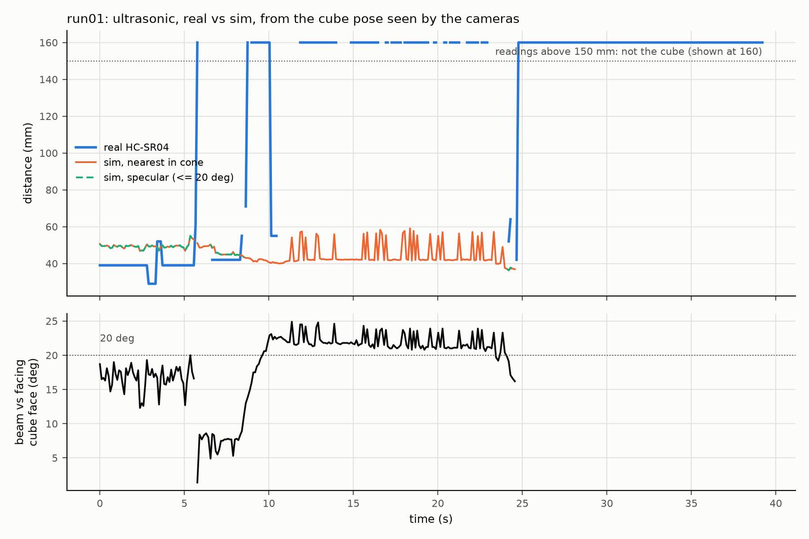

| Sim model | Agrees with real on "cube seen" | Sim − real when both see it |
|---|---|---|
| nearest hit in the cone | 36% (80/223) | median +9.8 mm |
| **echo only if incidence ≤ 20°** | **94% (209/223)** | median +9.9 mm |

- With the cube tilted (9–23 s) the face towards the sensor is at 21–25° to the beam; the real sensor reads the wall beyond 640 mm or nothing, as the user observed. **The incidence model reproduces this, the nearest-hit model does not.**
- The threshold is not pinned down by this run (tilted 21–25°, seen ≤ 20°): θ = 18° gives 86%, 20° 88%, 22° 50% with the facing-face rule. More angles needed.
- The +10 mm distance bias comes from the fused cube position (≈ 10 mm x bias, same source as the 5–10 mm inter-camera inconsistency); measured directly in the side image (8.3) the error is within ±4 mm.

### 8.7 Incidence threshold (angle01 / angle02)

The cube on the palm is held by its far side and slowly turned about the vertical between ±45°, recorded 60 s (`real2sim/ultrasonic/incidence_analysis.py`, `threshold_sweep.py`).

- **angle01 discarded**: the cube was too close (≈ 2 cm); most readings are dead-zone values 17 / 20 mm (213), independent of angle. The analysis now drops readings < 25 mm.
- **angle02** (cube on the far palm, ≈ 7 cm, real median 74 mm, no dead-zone samples):

| Facing-face angle to the beam | Real sensor sees the cube |
|---|---|
| 10–20° | 83% |
| 20–25° | 71% |
| 25–30° | 39% |
| 35–40° | 4% |

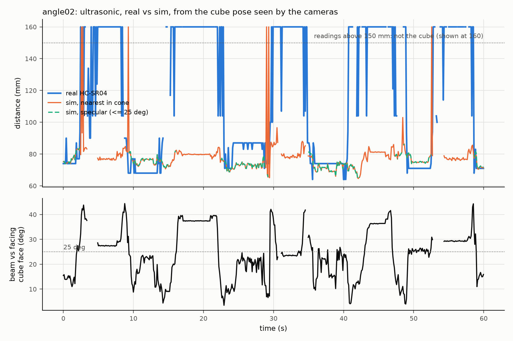

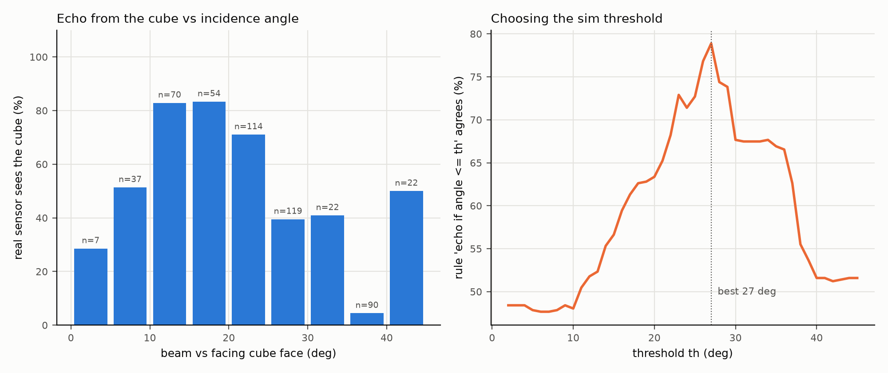

**Choice of the per-ray threshold** (dead-zone samples excluded):

| Threshold | run01 (≈ 4 cm) | angle02 (≈ 7 cm) | Total |
|---|---|---|---|
| 15° | 94% | 63% | 72% |
| 20° | 95% | 75% | 81% |
| **25°** | 90% | **88%** | **88%** |
| 30° | 90% | 87% | 88% |
| none (nearest hit) | 36% | 51% | 46% |

- **25°** adopted (`ultrasonic.max_incidence_deg` in `rig.yaml`): 88–91% on both. Chosen on these two datasets (in-sample); needs new data to confirm.
- Regenerated with 25°: run01 91% (202/223), angle02 88% (469/535). When both see the cube, angle02 sim − real median −0.1 mm, MAE 7.3 mm; run01 (cube near the wrist, ≈ 4 cm) +9.8 mm, where the fused position bias is larger.

### 8.8 Policy replay run02 and joint pose checks (posecheck02/03, abdcheck01–03)

**run02**: the ending now releases the thumb first, then the other fingers; joint speed limit 40°/s; 38 s replay. The fingers opened too wide and the cube fell. The trajectory shows:

- The sim policy starts from "all joints 0°" (fingers straight) while the real hand rests at neutral (slightly bent); the policy also bends fingers backwards: ring_mcp to −24.7° (33% of the time at the limit), middle_mcp −17°, every pip −14.6°.
- thumb_mcp is clamped at the real limit 40° 74% of the time (the sim goes to 100°): the thumb basically does not move the sim's way.
- Slowed 13×, the dynamic contact effects the policy relies on are gone.
- Conclusion: even with perfect joint calibration, open-loop replay of the sim policy hardly reproduces the manipulation. This is itself a sim2real finding.

**Joint pose check** (`real2sim/hand/pose_check.py`): replay 6 known poses (neutral, all 0°, four fingers at 45°, thumb bent, fingers spread, neutral), 4 s each, wrist at neutral −9.6°, while recording; the replay start is found from frame differences (strongest still/moving contrast), and the sim hand is rendered at exactly the same angles over both camera views.

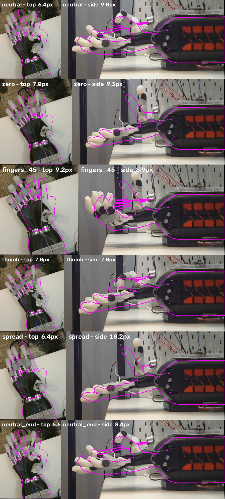

- **top view**: in every pose the sim hand is shifted towards the thumb and rotated relative to the real hand (real fingers ≈ 10–15° towards the pinky); the palm near the wrist is aligned. Changing the sim wrist (−19.2° … +9.6°) barely changes this (7.2 → 6.4 px): the sim wrist bends up/down, not sideways.
- **side view**: in "all 0°" the sim wrist at 0° fits best (8.0 px), the commanded −9.6° worse (9.3 px): for the same −9.6° command the real wrist bends only as much as sim 0°…−5°, a 5–10° wrist offset.
- Finger flexion (four fingers 45°) roughly matches in the side view; the thumb is further off.
- The real hand's joint calibration (orca_core `calibration.yaml`) was last updated 2026-09-08. The calibration in `orca_teleop-main` is the teleoperation stereo camera and human→robot retargeting, not the joint calibration.

**After recalibration (posecheck03)**: the user re-ran orca_core `calibrate.py` for index, middle, ring, pinky and thumb (wrist skipped so the hand and sensor would not move; old file backed up as `calibration.before-recal-20261120.yaml`) and recorded the same check. Score = median distance from the sim hand outline to the real image edges (Canny):

| Pose | top before → after (px) | side before → after (px) |
|---|---|---|
| neutral | 6.4 → 7.0 | 9.0 → 8.4 |
| all 0° | 7.0 → 6.2 | 9.3 → 8.2 |
| fingers 45° | 9.2 → 8.6 | 8.9 → 8.6 |
| thumb bent | 7.0 → 7.0 | 7.0 → 7.0 |
| spread | 6.4 → 6.0 | 10.2 → 9.2 |
| neutral (end) | 6.6 → 6.4 | 8.4 → 8.0 |
| **mean** | **7.1 → 6.9** | **8.8 → 8.2** |

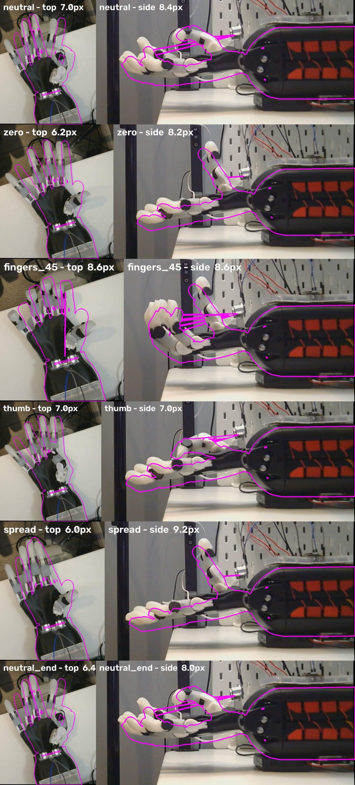

- Recalibration improved things only slightly (top −3%, side −7%).
- The largest remaining top-view error is in the **pinky and ring**: in "all 0°" and "spread" the real pinky and ring are further out than the sim; index and middle align.
- The edge score also includes background edges and only shows rough trends.

**Abduction check (abdcheck01)**: index, ring and pinky abduction each held at −20° / +20° with 0° in between, all other joints 0° (`pose_check.py make abd`).

- The automatic fit (per finger, scan a −30…+30° correction to minimise the finger outline's distance to real edges) is **not trustworthy**: several results on the scan boundary, and the pinky "stays at +6° whatever the command", contradicting the visible motion. Neighbouring fingers look alike and the outline snaps to them.
- Instead, draw the sim finger at −20 / 0 / +20° over the same real frame and judge by eye.

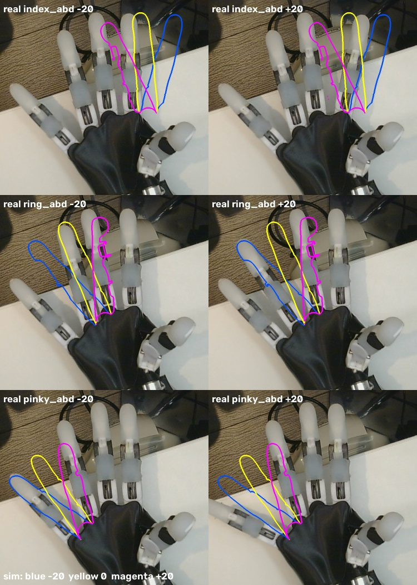

- **Ring and pinky abduction run opposite in sim and real** (at that time): in the sim + moves inwards (towards the middle finger); on the real hand −20° → +20° spreads outwards. `sim_to_real.py` already flips index_abd ("index_abd is defined with the opposite sign") but not ring_abd / pinky_abd.
- The real "0°" is also spread further out than sim 0°. Drawing `sim = −command + offset`:

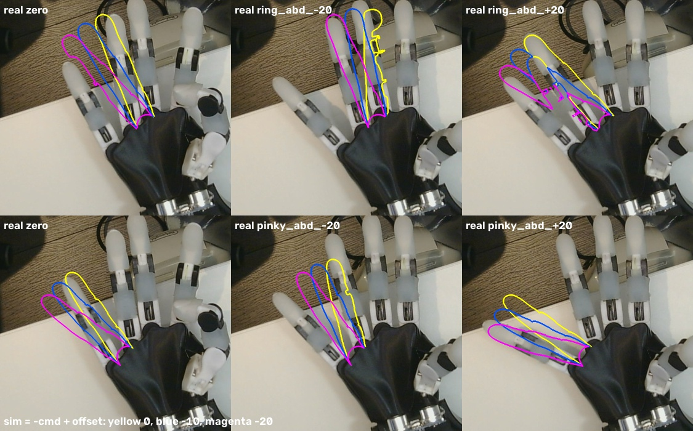

- Best by eye: ring offset ≈ −20°, pinky ≈ −25…−30° (±5–10°).

**Fix and validation (abdcheck03)**: `real2sim/hand/joint_map.py` used `sim = −command + offset` for ring_abd / pinky_abd (−20°, −27°), all other joints as in `sim_to_real.py`. A check file with sim-angle targets (ring −25 / −10 / +5°, pinky −28 / −15 / 0°) was recorded:

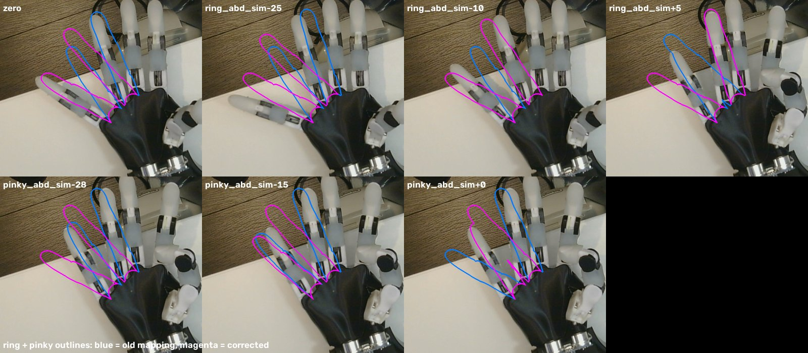

- The corrected outlines fit the real fingers in "all 0°", pinky sim 0° etc.; the old mapping predicted an almost horizontal pinky, the real one was nearly upright.
- Offsets estimated on abdcheck01 held on the independent abdcheck03. (This mapping was later invalidated by another hand calibration, see 8.16.)

### 8.9 run03: wrist −10…+10°, and aligning the full twin

- Trajectory with the corrected mapping and `--wrist-range -10 10`. With the wrist allowed, the sim policy succeeds in 0.75 s (another start orientation) instead of not within 2 s: the policy relies on the wrist.
- The cube started too close (20–29 mm, dead zone); ≈ 4 s fingers open and wrist turns; 6.5 s the thumb pushes the cube; **7.8 s the cube slides off**; 14.3 s the user puts it back (hand in view). Only 22 s recorded (replay 37.9 s).
- The forearm tower did not move (`real2sim/recording/tower_check.py`: 0.00 px median feature shift in both cameras).
- A cube-only sim agrees with the real "something seen" only 45% of the time: the fingers moving in front of the sensor are often what the real sensor sees.

**Full digital twin** (`real2sim/recording/twin.py`): the sim hand follows the replay file's commanded angles (through the mapping), the cube is placed at the camera pose, the ultrasonic sees both and records what it hits. This needs the replay start time within the recording:

1. Cross-correlating image change with commanded joint speed: correlation 0.22, clearly too early.
2. "First clear motion after stillness": triggered by the thumb pushing the cube at ≈ 7 s; the 2 s ramp was too slow to pass the threshold.
3. Pose matching (render the sim hand for different start times and compare outlines): any start before the recording scores ≈ 6.0 px, **no unique optimum**.
- Conclusion: **run03's alignment is unreliable; its full-twin comparison is not used** (marked in the data).

**Fix: let the replay log its own time.** `real2sim/recording/replay_logged.py` drives the hand exactly like orca_core's `replay_continuous.py` (create_hand / connect_hand / init_joints / set_joint_positions, run by the user in the orca environment, Ctrl+C stops) and also writes the `time.perf_counter()` of every frame sent to `real2sim/data/replay_logs/<name>.csv`. On Windows perf_counter is the system-wide QueryPerformanceCounter, the same clock the recorder uses; `record.py` stores its clock origin in `meta.json` (`perf_counter_origin`), so `twin.py <recording> <replay file> <log>` knows exactly which frame the real hand executes at every moment.

### 8.10 run04: time-logged replay and full twin

- Replayed with `replay_logged.py`; recording and replay **exactly aligned** (first replay frame t = 87.651 s, recording from 87.559 s; 822 of 1149 frames sent, stopped early). Tower shift ≈ 1 px (0.25 mm).
- The cube fell at ≈ 4 s.

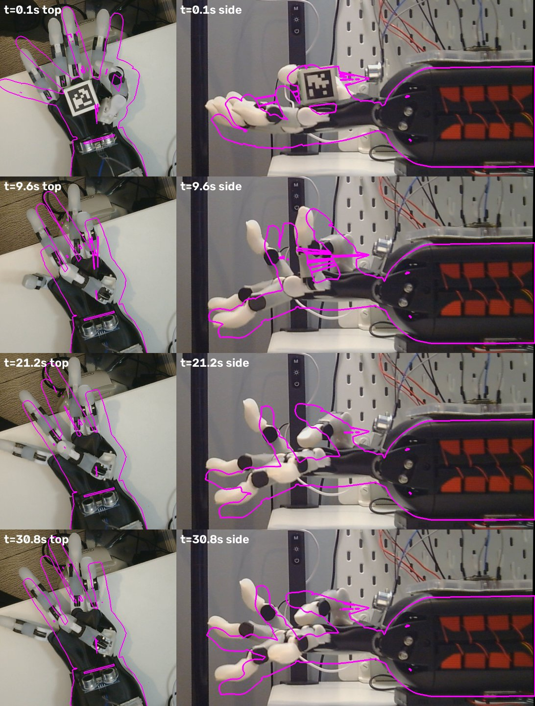

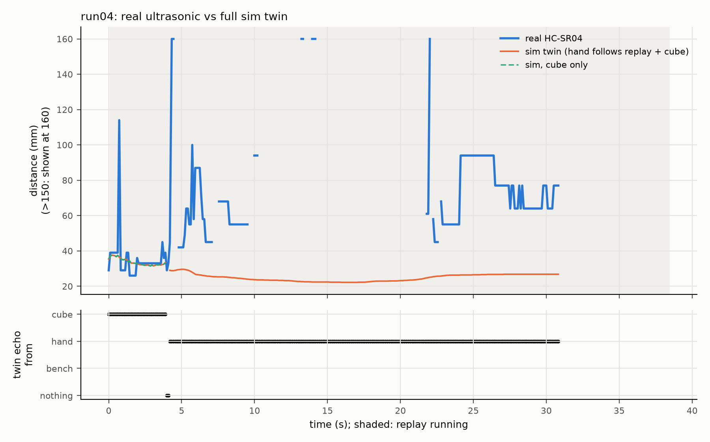

- With the cube on the hand (0–4 s) the twin echo comes from the cube and is close to real (≈ 30–40 mm).
- After the drop the twin reads 22–29 mm, the real sensor 42–94 mm; "something within 150 mm" agrees 62%.
- 49 of 56 such samples hit **`R-T-AP` (thumb base)**: the sim thumb base swings into the 15° cone, the real one does not.
- (run04 moved the wrist; Section 8.12 later showed the sensor moves with it, so this run's ultrasonic twin is not valid.)

### 8.11 run05: green face to the pinky, wrist locked (first time the cube stays)

- Start: green face to the pinky (normal +y), wrist locked at neutral −9.6°, corrected mapping. Before the replay sim 28.6 mm, real 29.0 mm (0.4 mm).
- Full replay (961 / 961 frames), exactly aligned. **The cube stayed on the palm throughout**, the first time it did not fall.
- Cameras and tower did not move (top background rotation 0.009°, 725 features, residual 0.27 px; tower 0.00 px). `tower_check.py` first reported 19 px in the top view because its region included the tower front with the moving cube and thumb; it now checks only the rear of the tower.

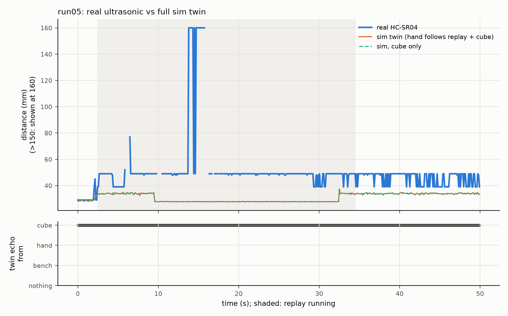

| Phase | Real | Sim twin | Facing-face incidence | Cube x (cameras) |
|---|---|---|---|---|
| 0–2 s (before replay) | 29.0 mm | 28.6 mm | 20.1° | 149.6 mm |
| 3–9 s | 49.0 mm | 34.0 mm | 17.9° | 154.7 mm |
| 10–30 s | 49.0 mm | 27.8 mm | 15.6° | 149.2 mm |
| 33–50 s (after replay) | 49.0 mm | 33.9 mm | 17.9° | 154.6 mm |

- By the cameras the cube moved only ≈ 5 mm at 16–20° incidence, but the real reading jumped from 29 to 49 mm when the replay started and stayed: the real sensor no longer receives the echo of the cube's face, while the twin (25° threshold) still does.
- **Likely physical cause: the HC-SR04 is bistatic**, transmitter and receiver 26 mm apart. At short range a slightly tilted face reflects the echo past the receiver; the tolerated tilt grows with distance. This matches the distance dependence of the threshold: run01 (≈ 4 cm) best 15–20°, angle02 (≈ 7 cm) best 25–30°. Next step: a bistatic model in the sim (emit from the transmitter, reflect specularly, count an echo only if the reflected ray reaches the receiver within its acceptance angle).
- The fingers did not reach the cube in run05: it sat 1.5–2 cm towards the wrist from the sim training position (x = 0.17 m).

### 8.12 run06: wrist ±15°, the ultrasonic sensor moves with the wrist

- Setup: green face to the pinky, policy allowed to turn the wrist within −15…+15° (actually −15…+2.7°).
- The real reading clearly followed the wrist. `sensor_track.py` tracks the sensor's image patch in both cameras against the commanded wrist angle: correlation top **+0.86**, side **+0.88**; up to 63 px (≈ 1.5 cm) at +3°, and 2–3 px off after returning.
- Cause: the sensor only **rests** on the palm base, it is not (and cannot be) attached. The sim sensor is fixed in the world, so **every replay that moved the wrist (run03, run04, run06) has an invalid ultrasonic twin**. All later runs lock the wrist.

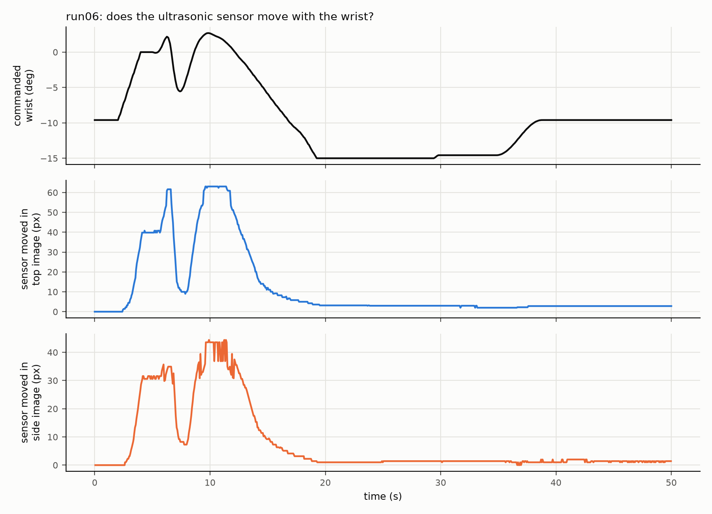

### 8.13 With the wrist locked, which cube orientation does the policy act on most (sim sweep)

`orientation_sweep.py`: cube at the training position in the sim, wrist action 0, 2 s of the deterministic policy for each of 6 green-face directions.

| Green face | Moved (mm) | Turned (°) | Goal reached | Dropped |
|---|---|---|---|---|
| up (+z) | 16.6 | 36.9 | 0.01 s (already at start) | no |
| down (−z) | 13.2 | 32.9 | – | no |
| fingertips (+x) | 13.8 | 47.5 | – | no |
| wrist (−x) | 17.0 | 18.9 | – | no |
| **pinky (+y)** | 17.3 | **87.2** | **0.65 s** | no |
| thumb (−y) | 25.2 | 62.8 | – | no |

With the green face to the pinky the fingers act on the cube most, and it is the only orientation that actually completes the turn, so run05, run07 and run08 use it.

### 8.14 run07: cube at the training position (x = 169.7 mm), wrist locked

- Tower and sensor did not move (tower top 0.00 px, side 0.80 px; sensor 0.0 px). 1107 replay frames from t = 89.071 s.

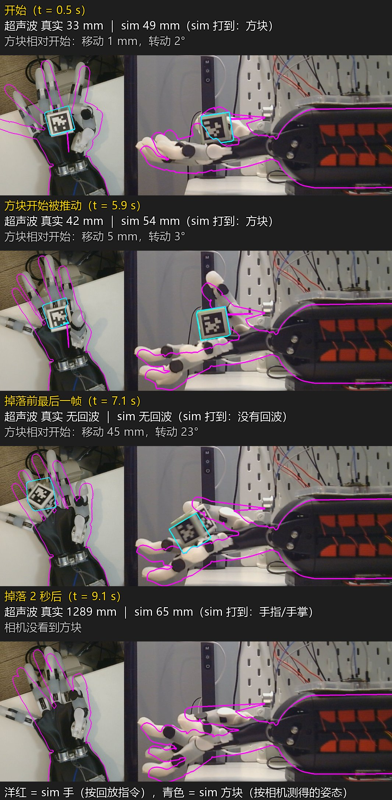

| Time | What happens | Ultrasonic real / sim (sim hits) |
|---|---|---|
| 0.5 s | cube on the palm | 33 / 49 mm (cube) |
| 5.9 s | fingers bend, cube pushed 5 mm, turned 3° | 42 / 54 mm (cube) |
| 7.1 s | cube pushed to the fingertip side, moved 45 mm, turned 23° | no echo / no echo |
| 9.1 s | cube has fallen off the fingertip side | 1289 mm (wall) / 65 mm (fingers) |

- During the replay "something within 150 mm" agrees 78%; twin echo from cube 46, hand 78, none 215. When both see something, twin − real median **+6.9 mm**, MAE 9.9 mm (n = 48).
- With the cube on the palm the sim is 12–16 mm further than real; see 8.15.

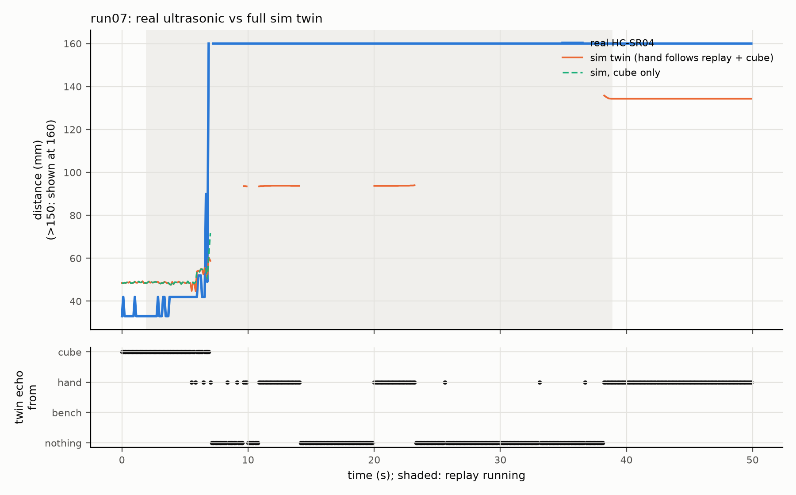

### 8.15 static01: re-checking the sensor position (cube still)

- Purpose: is run07's 12–16 mm gap caused by an outdated sensor position? Thumb opened by hand, cube still for a few seconds at several palm positions (30 s recording).
- 263 of 269 samples agree on "cube seen"; when both see it, sim − real median **+0.7 mm**, MAE 5.9 mm. 0–2 s (≈ 49 mm) and 20–28 s (≈ 42 mm) overlap almost exactly; at 8–12 s the cube is inside the 20 mm dead zone (real 29 mm, sim clamped at 20 mm).
- Conclusion: **the sensor position is fine**. run07's gap is more likely the curled real thumb (thumb_dip 72° at the start) in the beam: the sensor points ≈ 15° towards the thumb side (direction y component −0.262), and the sim thumb is not exactly where the real one is.

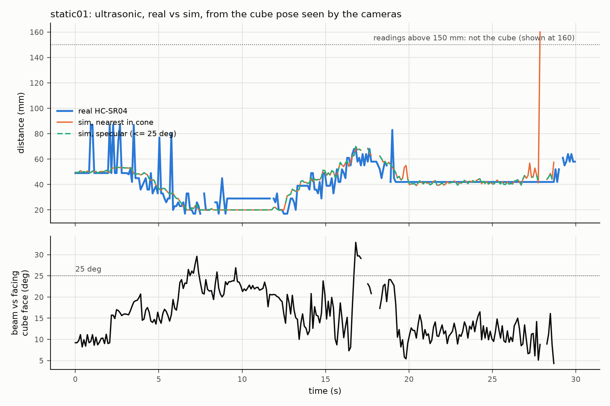

### 8.16 Full-hand joint check (fullcheck01) and the mapping after recalibration

- The user **re-ran the orca_core calibration after abdcheck03**. `pose_check.py make full`: every finger joint alone at two angles, others 0, back to 0 after each finger; 40 poses held 3 s, 3.5 s transitions, max 36°/s, 256.5 s. Replayed with `replay_logged.py` (log fullcheck01), exactly aligned.
- The edge score is 6–8 px for every pose and separates nothing; the automatic fit is fooled by neighbouring fingers and side-view occlusion. So `finger_zoom.py` makes close-ups per finger (only the tested finger's sim outline) for judging by eye.
- Results:
  - Thumb (4 joints), index abduction, finger flexion (mcp/pip): correct direction, magnitude within ≈ 10° by eye. The thumb is not reversed.
  - **Ring and pinky abduction now run opposite to the abdcheck03 correction**: a negative command spreads outwards, positive pulls in; the pinky's zero is spread ≈ 35° (≈ 60° in abdcheck03). The calibration changed the direction and zero of these two joints.
- New mapping (`joint_map.py`): sim = core + offset, ring_abd −10°, pinky_abd −14° (one-parameter fit + visual check; the pinky fits in all three poses, the ring at ±20° and a few degrees out at zero). Old values (sign −1, −20° / −27°) kept in a comment.

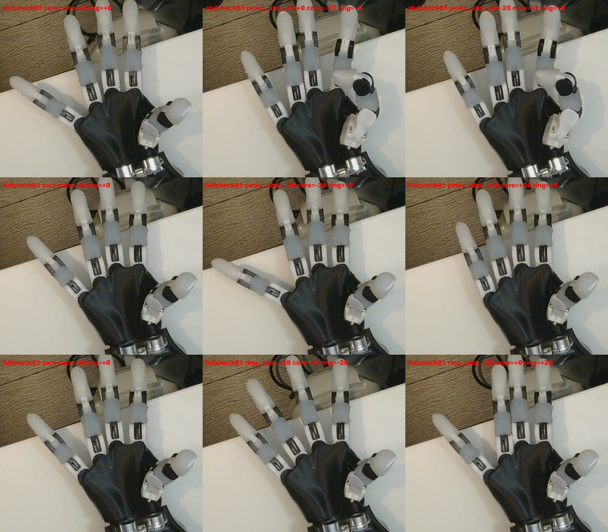

### 8.17 run08: new mapping, green face to the pinky, wrist locked

- Start: cube centre x = 174 mm, green-face normal (0.15, 0.99, −0.09), ultrasonic real 45 mm, sim 52 mm. Trajectory 36.1 s (12× slower); pinky abduction at its adduction limit +30° for 735 frames (the policy wants it further in), thumb abd at its limit 35° for 741 frames.
- Tower did not move (top 0.00 px, side 0.27 px). 1082 replay frames from t = 83.877 s.

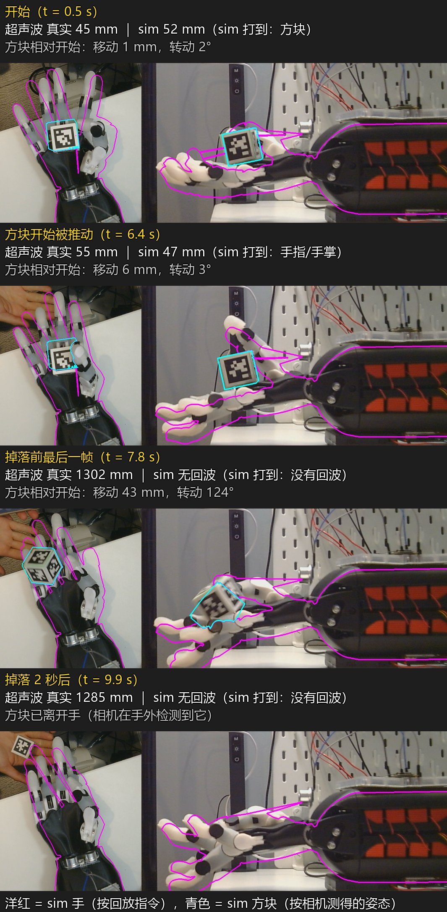

- ≈ 6.4 s the fingers start pushing the cube; at 7.8 s the cube rolls over the fingers towards the pinky, **already turned 124°** (run07 at most 23°); then it rolls off on the pinky side. From 6.0 s the user's hand is in the top view, only catching the cube far below the robot hand without touching the cube or the hand, so the whole run is valid.
- Ultrasonic during the replay: agreement 79%; twin echo from cube 47, hand 72, none 214; when both see something twin − real median **+6.3 mm**, MAE 7.3 mm (n = 50).

| | run07 | run08 |
|---|---|---|
| max cube rotation | 23° | 124° |
| falls off | fingertip side | pinky side |
| "something seen" agreement | 78% | 79% |
| twin − real (median) | +6.9 mm | +6.3 mm |
| MAE | 9.9 mm | 7.3 mm |

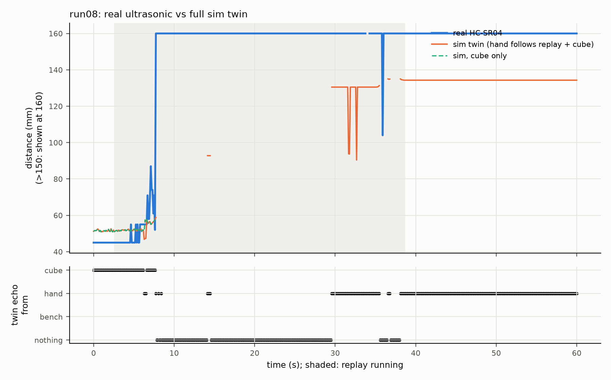

- With the corrected mapping the fingers act on the cube much more, but it still falls: open-loop replay, the policy cannot see the real cube (in the sim this trajectory did not reach the goal either).

### 8.18 Data collection notes

- A camera or serial port can be opened by one program at a time; an open preview window or serial monitor blocks the recorder.
- Lock the wrist: the ultrasonic sensor only rests on the palm base and moves with the wrist, which invalidates the ultrasonic twin (8.12).
- After any hand calibration, redo the joint check (8.16): calibration can change joint directions and zeros.
- Put the cube at the sim training position (x ≈ 0.17 m) before a replay, otherwise the fingers do not reach it (run05).
- Run real2sim scripts from the repo folder and replays from the orca folder (each command below starts with its `cd`).

### 8.19 Dataset for teammates

`real2sim/dataset_package/` (and `real2sim/dataset_package.zip`, 0.5 MB), built by `real2sim/recording/package.py`: per run `dataset.csv`, `dataset_twin.csv`, `meta.json`, `twin_meta.json`, `replay_log.csv` (recording time base) and the replay trajectory; `calib/` with the camera, rig and tag files; `README.md` with every column, unit, frame and which runs are valid. Camera frames are not included (they stay in `real2sim/data/recordings/<run>/top|side/`; the CSVs give their paths).

| Run | Use |
|---|---|
| angle01, angle02 | incidence threshold (cube turned by hand) |
| static01 | static ultrasonic check |
| run01 | first policy replay (old mapping) |
| run03, run04, run06 | wrist moved → ultrasonic twin invalid; camera/cube data fine |
| run05 | wrist locked, cube off the training position |
| **run07, run08** | valid full-twin runs (run08 with the current mapping) |

---

## 9. Reproduction (commands)

Real2sim scripts run from the repo folder; hand replays run from the orca folder with its environment. Nothing here writes to the serial ports; the user runs every replay.

```bash
# ---- cameras ----
cd "C:\Users\Owner\Desktop\ORCA project\SEP730-Dexterous-Hand-Simulation"
# 0. print the board (Letter, 100%), glue to a rigid board, check the 100 mm bar and the grid length
python real2sim/cameras/make_targets.py

# 1. intrinsics (once per camera; whole board in view, cover corners and edges, tilt 30-45 deg, SPACE to save)
python real2sim/cameras/capture.py intr_top  --cams top
python real2sim/cameras/capture.py intr_side --cams side
python real2sim/cameras/calibrate_intrinsics.py intr_top  --cam top
python real2sim/cameras/calibrate_intrinsics.py intr_side --cam side

# 2. extrinsics: top board flat (measure D, B), side board against the tower (measure a, M); values into rig.yaml
python real2sim/cameras/capture.py extr_top  --cams top
python real2sim/cameras/capture.py extr_side --cams side
python real2sim/cameras/calibrate_extrinsics.py --cam-session top=extr_top --cam-session side=extr_side

# 2b. if a camera was bumped slightly afterwards
python real2sim/cameras/correct_bump.py top real2sim/data/extr_top/top/008.png real2sim/data/extr_top/after_bump.png

# 3. check and make the figures
python real2sim/cameras/show_scene.py --calibrated
cd real2sim/cameras && python make_figures.py

# ---- ultrasonic ----
cd "C:\Users\Owner\Desktop\ORCA project\SEP730-Dexterous-Hand-Simulation"
python hardware/ultrasonic/read_ultrasonic.py --raw
python real2sim/ultrasonic/twin_check.py locate --top-a U V --side-a U V --top-b U V   # transducer pixels

# ---- cube tags ----
python real2sim/cube/cube_tags.py capture     # turn the cube under the top camera
python real2sim/cube/cube_tags.py solve

# ---- joint check (after any hand calibration) ----
python real2sim/hand/pose_check.py make full            # -> orca/replay_sequences/pose_check_full.yaml
python real2sim/recording/record.py fullcheck01 --seconds 290
#   second terminal (orca folder):
#   cd C:\Users\Owner\Desktop\orca
#   uv run python "C:\Users\Owner\Desktop\ORCA project\SEP730-Dexterous-Hand-Simulation\real2sim\recording\replay_logged.py" orca_core/models/v2/orcahand_right/config.yaml --replay-file pose_check_full.yaml --log fullcheck01
python real2sim/hand/pose_check.py compare fullcheck01 full fullcheck01
python real2sim/hand/finger_zoom.py fullcheck01 full fullcheck01

# ---- policy run (cube at x ~ 0.17 m, green face to the pinky, wrist locked) ----
python real2sim/recording/record.py start08 --seconds 3
python real2sim/cube/snapshot_from_recording.py start08
python real2sim/cube/check_pose.py real2sim/data/recordings/start08/snapshot
python real2sim/policy/policy_to_replay.py --start-from real2sim/data/recordings/start08/snapshot --out policy_run08.yaml
python real2sim/recording/record.py run08 --seconds 60
#   second terminal (orca folder), after the countdown:
#   uv run python "...\real2sim\recording\replay_logged.py" orca_core/models/v2/orcahand_right/config.yaml --replay-file policy_run08.yaml --log run08

# ---- processing ----
python real2sim/recording/tower_check.py run08
python real2sim/recording/process.py run08                       # dataset.csv
python real2sim/recording/twin.py run08 policy_run08.yaml run08  # dataset_twin.csv
python real2sim/recording/keyframes.py run08 policy_run08.yaml run08
python real2sim/recording/sensor_track.py run08 policy_run08.yaml run08
python real2sim/recording/package.py                             # dataset_package (+ .zip)
```
